# Activité 3 : Ansible, API Express et Dockerisation

## Structure du dépôt

```
.
├── ansible/
│   ├── inventory
│   ├── install-packages.yml
│   └── install-docker.yml
├── api/
│   ├── Dockerfile
│   ├── package.json
│   ├── server.js
│   └── data/
│       ├── profile.js
│       ├── projects.js
│       └── skills.js
├── portfolio/
│   ├── Dockerfile
│   ├── .dockerignore
│   ├── .env.example
│   ├── next.config.js
│   ├── lib/api.js
│   └── app/page.js
└── docker-compose.yml
```

---

## VII. Automatisation avec Ansible

### 25. Installation d'Ansible (VM d'administration)

```bash
sudo apt update && sudo apt install -y ansible
ansible --version
```


### 26. Inventory et test de communication

Fichier `ansible/inventory` :

```ini
[servers]
ubuntu-server ansible_host=192.168.1.20 ansible_user=ubuntu

[servers:vars]
ansible_python_interpreter=/usr/bin/python3
```

Commandes :

```bash
ssh-copy-id ubuntu@192.168.1.20
ansible all -i inventory -m ping
```

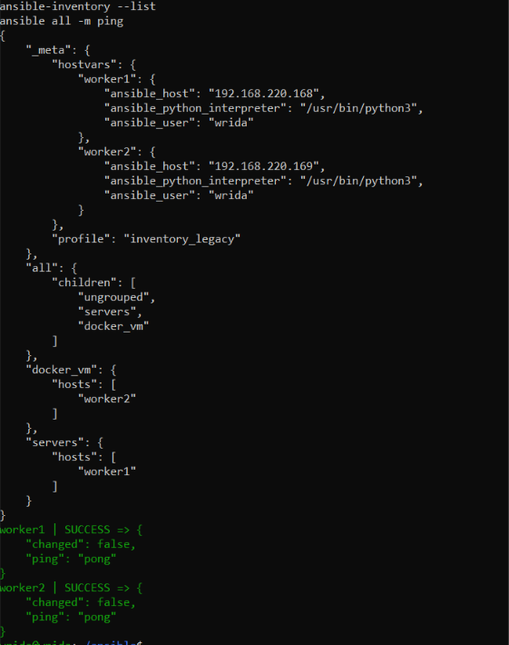

### 27. Premier playbook : installation de curl et git

Fichier `ansible/install-packages.yml` :

```yaml
---
- name: Installer curl et git
  hosts: all
  become: true
  tasks:
    - name: Mettre à jour le cache apt
      ansible.builtin.apt:
        update_cache: true
        cache_valid_time: 3600

    - name: Installer curl et git
      ansible.builtin.apt:
        name:
          - curl
          - git
        state: present
```

Exécution :

```bash
ansible-playbook -i inventory install-packages.yml
```

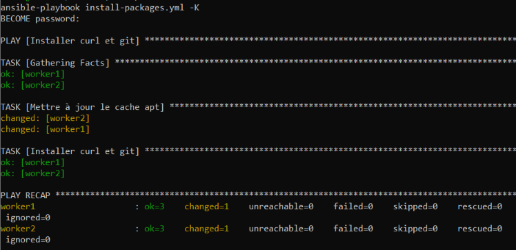

### 28. Playbook d'installation de Docker

Fichier `ansible/install-docker.yml` :

```yaml
---
- name: Installer Docker sur une nouvelle VM
  hosts: all
  become: true
  tasks:
    - name: Installer les prérequis
      ansible.builtin.apt:
        name: [ca-certificates, curl, gnupg]
        state: present
        update_cache: true

    - name: Créer le dossier des clés
      ansible.builtin.file:
        path: /etc/apt/keyrings
        state: directory
        mode: "0755"

    - name: Ajouter la clé GPG Docker
      ansible.builtin.get_url:
        url: https://download.docker.com/linux/ubuntu/gpg
        dest: /etc/apt/keyrings/docker.asc
        mode: "0644"

    - name: Ajouter le dépôt Docker
      ansible.builtin.apt_repository:
        repo: "deb [arch=amd64 signed-by=/etc/apt/keyrings/docker.asc] https://download.docker.com/linux/ubuntu {{ ansible_distribution_release }} stable"
        state: present
        filename: docker

    - name: Installer Docker
      ansible.builtin.apt:
        name:
          - docker-ce
          - docker-ce-cli
          - containerd.io
          - docker-compose-plugin
        state: present
        update_cache: true

    - name: Démarrer et activer Docker
      ansible.builtin.service:
        name: docker
        state: started
        enabled: true

    - name: Ajouter l'utilisateur au groupe docker
      ansible.builtin.user:
        name: "{{ ansible_user }}"
        groups: docker
        append: true
```

Exécution et vérification :

```bash
ansible-playbook -i inventory install-docker.yml
ssh ubuntu@192.168.1.20 "docker --version"
```

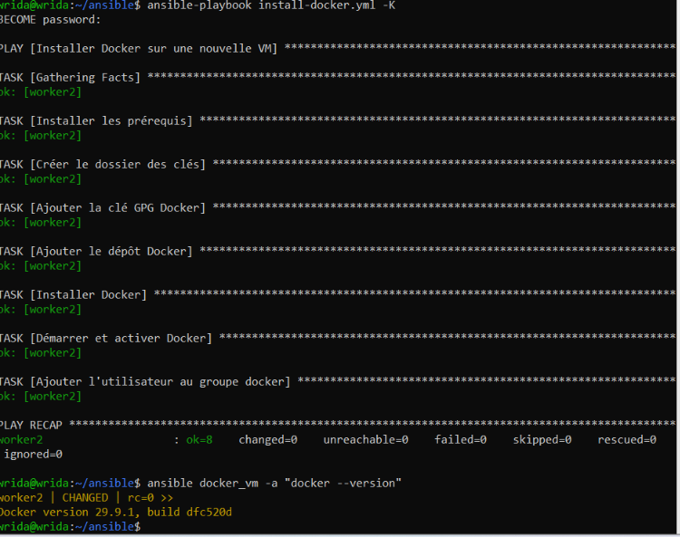

---

## VIII. API Node.js / Express

### 29. Création de l'API

Structure du projet : voir l'arborescence en haut de ce document (dossier `api/`).

```bash
mkdir api && cd api
npm init -y
npm install express cors
npm start
```

`package.json` contient `"scripts": { "start": "node server.js" }`. L'API est indépendante du frontend et écoute sur le port 3001.

`api/server.js` :

```js
const express = require("express");
const cors = require("cors");
const profile = require("./data/profile");
const projects = require("./data/projects");
const skills = require("./data/skills");

const app = express();
const PORT = process.env.PORT || 3001;

app.use(cors());

app.get("/api/health", (req, res) =>
  res.json({ status: "ok", uptime: process.uptime(), timestamp: new Date().toISOString() })
);
app.get("/api/profile", (req, res) => res.json(profile));
app.get("/api/projects", (req, res) => res.json(projects));
app.get("/api/skills", (req, res) => res.json(skills));

app.listen(PORT, "0.0.0.0", () => console.log(`API démarrée sur le port ${PORT}`));
```

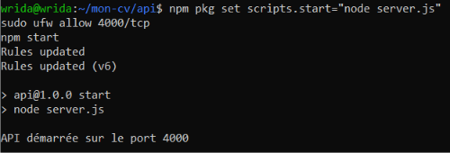

### 30. Route `GET /api/health`

```bash
curl http://localhost:3001/api/health
```

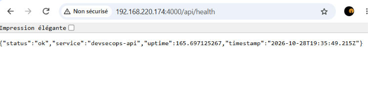

### 31. Route `GET /api/profile`

`api/data/profile.js` :

```js
module.exports = {
  name: "Votre Nom",
  title: "Étudiant DevSecOps",
  bio: "Courte présentation...",
  email: "vous@example.com",
  github: "https://github.com/votre-compte",
};
```

```bash
curl http://localhost:3001/api/profile
```

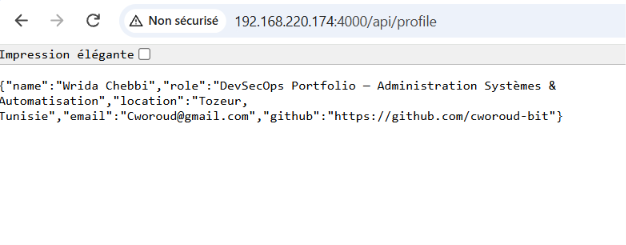

### 32. Route `GET /api/projects`

`api/data/projects.js` :

```js
module.exports = [
  { id: 1, title: "Portfolio DevSecOps", description: "Site Next.js conteneurisé", tags: ["Next.js", "Docker"] },
  { id: 2, title: "Pipeline CI/CD", description: "Build, tests et scan de sécurité", tags: ["GitHub Actions", "Trivy"] },
];
```

```bash
curl http://localhost:3001/api/projects
```

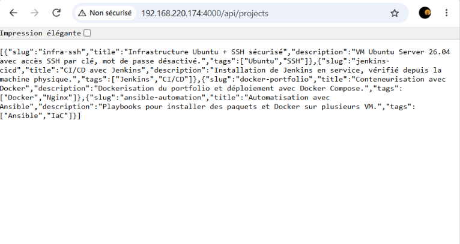

### 33. Route `GET /api/skills`

`api/data/skills.js` :

```js
module.exports = [
  { id: 1, name: "Docker", level: "Intermédiaire" },
  { id: 2, name: "Ansible", level: "Débutant" },
  { id: 3, name: "Linux", level: "Intermédiaire" },
];
```

```bash
curl http://localhost:3001/api/skills
```

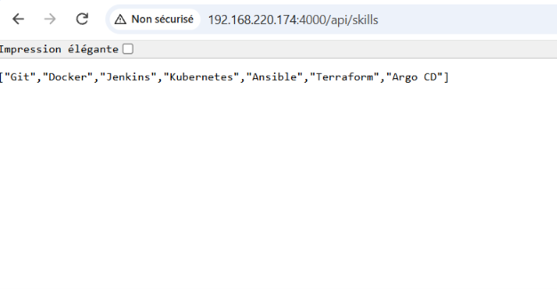

### 34. Frontend : projets depuis l'API

Le frontend ne lit plus de données locales. Un Server Component Next.js appelle l'API Express via `fetch`. L'option `cache: "no-store"` force la requête à l'exécution et non au build, ce qui est nécessaire en Docker car l'API n'existe pas pendant le build du frontend.

`portfolio/lib/api.js` :

```js
const API_URL = process.env.API_URL || "http://localhost:3001";

export async function getProjects() {
  const res = await fetch(`${API_URL}/api/projects`, { cache: "no-store" });
  if (!res.ok) throw new Error("Impossible de charger les projets");
  return res.json();
}

export async function getSkills() {
  const res = await fetch(`${API_URL}/api/skills`, { cache: "no-store" });
  if (!res.ok) throw new Error("Impossible de charger les compétences");
  return res.json();
}
```

`portfolio/app/page.js` :

```jsx
import { getProjects, getSkills } from "@/lib/api";

export default async function Home() {
  const [projects, skills] = await Promise.all([getProjects(), getSkills()]);
  return (
    <main>
      <h2>Projets</h2>
      <ul>{projects.map(p => <li key={p.id}><strong>{p.title}</strong> : {p.description}</li>)}</ul>
      <h2>Compétences</h2>
      <ul>{skills.map(s => <li key={s.id}>{s.name} ({s.level})</li>)}</ul>
    </main>
  );
}
```

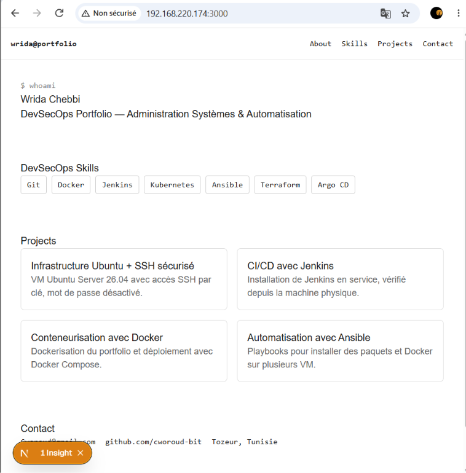

### 35. Frontend : compétences depuis l'API

Même principe avec `getSkills()` et la route `/api/skills`.

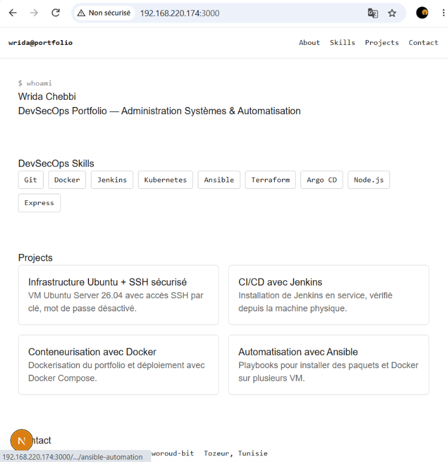

---

## IX. Variables d'environnement

### 36. Variable `API_URL`

Le frontend lit l'URL de l'API via `process.env.API_URL` (en local : `portfolio/.env.local`, non commité).

**Pourquoi ne pas coder l'URL en dur ?**
L'URL de l'API change selon l'environnement : `http://localhost:3001` en développement, `http://api:3001` dans Docker Compose, un domaine HTTPS en production. La coder en dur obligerait à modifier le code et à reconstruire l'image à chaque changement. Avec une variable d'environnement, la même image fonctionne partout et la configuration reste séparée du code.

### 37. Fichier `.env.example`

```env
# URL de l'API Express (aucun secret ici)
API_URL=http://localhost:3001
```

Le `.gitignore` ignore `.env*` sauf `.env.example`.

---

## X. Dockerisation

### 38. Dockerfile du frontend

`next.config.js` :

```js
module.exports = { output: "standalone" };
```

`portfolio/Dockerfile` :

```dockerfile
FROM node:20-alpine AS deps
WORKDIR /app
COPY package*.json ./
RUN npm ci

FROM node:20-alpine AS builder
WORKDIR /app
COPY --from=deps /app/node_modules ./node_modules
COPY . .
RUN npm run build

FROM node:20-alpine AS runner
WORKDIR /app
ENV NODE_ENV=production
RUN addgroup -S app && adduser -S app -G app
COPY --from=builder /app/public ./public
COPY --from=builder --chown=app:app /app/.next/standalone ./
COPY --from=builder --chown=app:app /app/.next/static ./.next/static
USER app
EXPOSE 3000
ENV PORT=3000 HOSTNAME=0.0.0.0
CMD ["node", "server.js"]
```

**Explication :** build multi-étapes (dépendances, build, exécution). L'image finale est légère car elle ne contient que le résultat du build en mode standalone, et l'application s'exécute avec un utilisateur non-root. Un `.dockerignore` exclut `node_modules`, `.next`, `.env*` et `.git`.

### 39. Dockerfile de l'API

`api/Dockerfile` :

```dockerfile
FROM node:20-alpine
WORKDIR /app
ENV NODE_ENV=production
COPY package*.json ./
RUN npm ci --omit=dev
COPY . .
USER node
EXPOSE 3001
CMD ["node", "server.js"]
```

**Explication :** image Alpine minimale, uniquement les dépendances de production, et exécution avec l'utilisateur `node` non privilégié.

### 40. Construction des images

```bash
docker build -t devsecops-portfolio ./portfolio
docker build -t devsecops-api ./api
docker images | grep devsecops
```

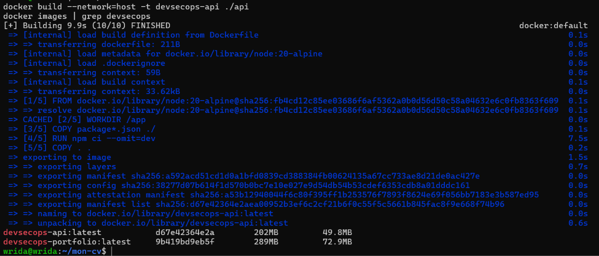

### 41. Docker Compose

`docker-compose.yml` :

```yaml
services:
  api:
    image: devsecops-api
    build: ./api
    container_name: devsecops-api
    ports:
      - "3001:3001"
    restart: unless-stopped

  frontend:
    image: devsecops-portfolio
    build: ./portfolio
    container_name: devsecops-portfolio
    ports:
      - "3000:3000"
    environment:
      - API_URL=http://api:3001
    depends_on:
      - api
    restart: unless-stopped
```

```bash
docker compose up -d --build
docker compose ps
```

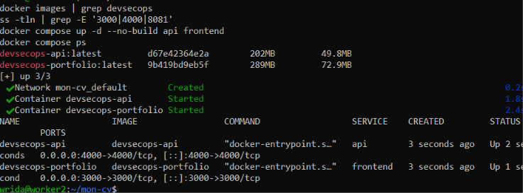

### 42. Communication frontend / API via le réseau Compose

Docker Compose crée un réseau par défaut où chaque service est joignable par son nom DNS. Le frontend appelle donc l'API avec `http://api:3001` (valeur de `API_URL`). L'appel est fait côté serveur par Next.js, il passe donc bien par le réseau Docker.

Preuve : après modification d'une valeur dans `api/data/skills.js` puis `docker compose up -d --build api`, le rechargement de `http://localhost:3000` affiche la nouvelle donnée sans toucher au frontend.

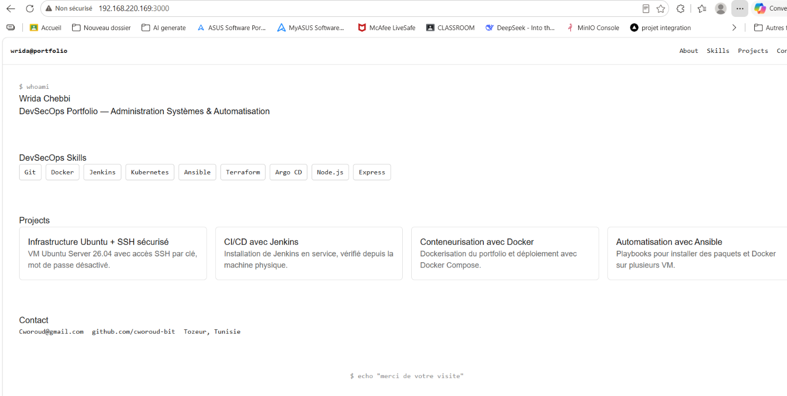
