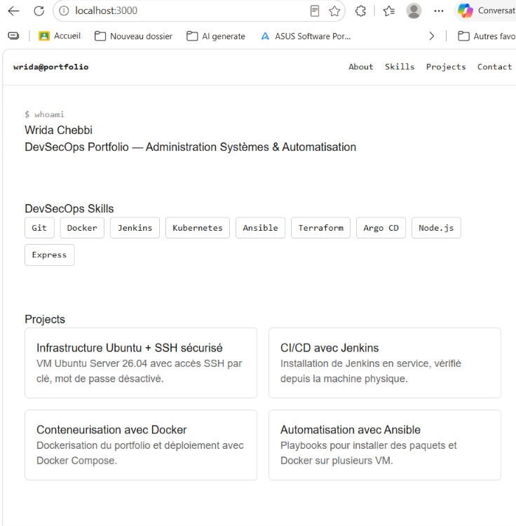
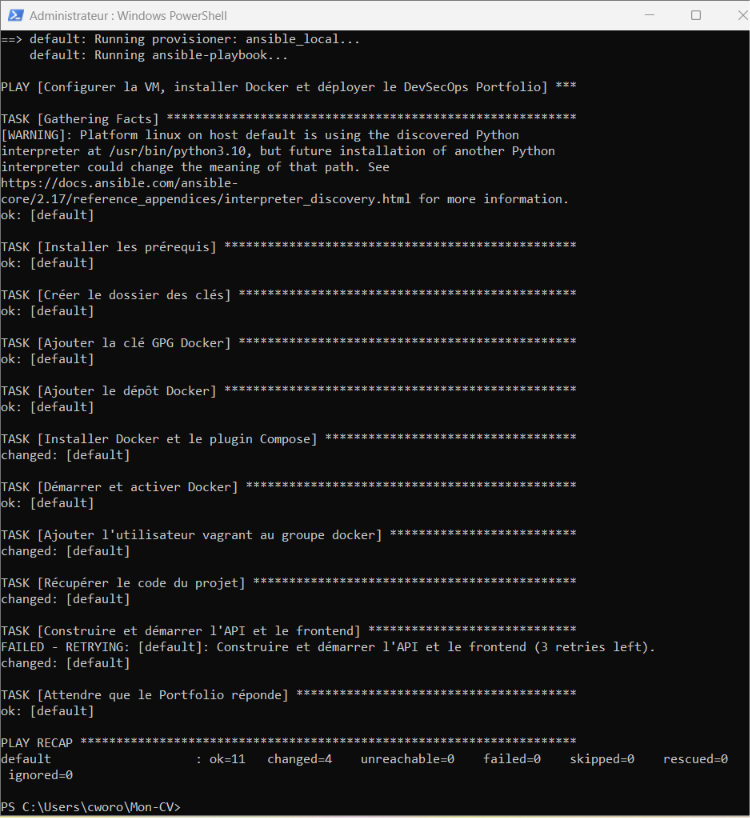
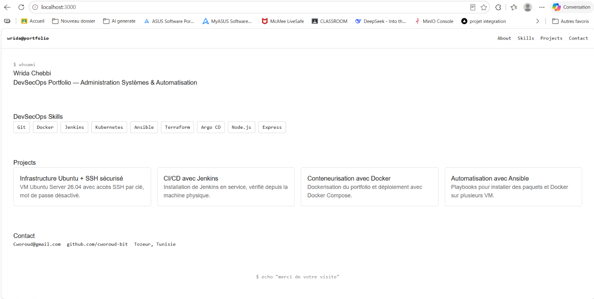

# Activité 4 : Vagrant + Ansible, sécurisation de l'API, PostgreSQL, tests et pipeline DevSecOps

## 11. Infrastructure automatisée avec Vagrant + Ansible

### 43. Playbook de déploiement du Portfolio avec Docker Compose

Fichier `ansible/deploy-portfolio.yml` (déploiement sur une VM qui a déjà Docker) :

```yaml
---
- name: Déployer le DevSecOps Portfolio avec Docker Compose
  hosts: docker_vm
  become: true
  vars:
    repo_url: https://github.com/cworoud-bit/Mon-CV.git
    repo_branch: activite-4
    app_dir: /opt/devsecops

  tasks:
    - name: Installer git
      ansible.builtin.apt:
        name: git
        state: present
        update_cache: true

    - name: Récupérer le code du projet
      ansible.builtin.git:
        repo: "{{ repo_url }}"
        dest: "{{ app_dir }}"
        version: "{{ repo_branch }}"
        force: true

    - name: Construire et démarrer api et frontend
      community.docker.docker_compose_v2:
        project_src: "{{ app_dir }}"
        services:
          - api
          - frontend
        build: always
        state: present
```

Commande utilisée :

```bash
ansible-playbook -i inventory deploy-portfolio.yml -K
```



### 44. Vagrant lance automatiquement Ansible

Chaîne obtenue : `vagrant up` → création de la VM → configuration Ansible → installation de Docker → déploiement du Portfolio.

`Vagrantfile` :

```ruby
Vagrant.configure("2") do |config|
  config.vm.box = "ubuntu/jammy64"
  config.vm.hostname = "devsecops-vm"
  config.vm.boot_timeout = 900

  config.vm.network "private_network", ip: "192.168.56.10"
  config.vm.network "forwarded_port", guest: 3000, host: 3000,
                    host_ip: "127.0.0.1", auto_correct: true

  config.vm.provider "virtualbox" do |vb|
    vb.name = "devsecops-vm"
    vb.memory = 3072
    vb.cpus = 2
  end

  # Après la création de la VM : Ansible (dans la VM) installe Docker et déploie le Portfolio
  config.vm.provision "ansible_local" do |ansible|
    ansible.playbook = "ansible/site.yml"
    ansible.compatibility_mode = "2.0"
  end
end
```

Le provisioner `ansible_local` installe Ansible dans la VM : aucune installation d'Ansible n'est nécessaire sous Windows. Le playbook `ansible/site.yml` installe Docker, clone le dépôt (branche `activite-4`), lance `docker compose up -d --build api frontend` (avec `retries` en cas d'échec réseau), puis attend que le Portfolio réponde sur le port 3000.

```powershell
vagrant up
```

Résultat : `PLAY RECAP : ok=11 changed=4 unreachable=0 failed=0`.



### 45. Test de reconstruction complète

```powershell
vagrant destroy -f
vagrant up
```

La VM est détruite puis recréée, et le Portfolio est redéployé automatiquement, sans intervention manuelle, sur `http://localhost:3000`.


