# Activité 5 : GitHub Actions, Git Workflow, images, registre et supply chain

Dépôt : `cworoud-bit/Mon-CV`. Ce document couvre les points 70 à 105.

---

## 17. GitHub Actions et sécurité GitHub

### 70 à 73. Workflow CI (`.github/workflows/ci.yml`)

Le workflow reprend les étapes du pipeline Jenkins de l'activité 4. Il se déclenche sur chaque `push` et sur chaque Pull Request vers `main`.

```yaml
on:
  push:
    branches: ["**"]
  pull_request:
    branches: [main]

permissions:
  contents: read

concurrency:
  group: ci-${{ github.ref }}
  cancel-in-progress: true
```

| Job | Point | Rôle |
|---|---|---|
| `tests` (matrice `devsecops-portfolio` et `api`) | 70 | `npm ci` puis `npm test` : 3 tests Vitest pour le frontend, 18 tests `node --test` pour l'API |
| `secrets` (Gitleaks) | 71 | Cherche des secrets dans l'historique Git (`fetch-depth: 0`) |
| `sast` (Semgrep) | 71 | Analyse statique du code de l'API et du frontend, échec sur sévérité `ERROR` |
| `dependencies` (`npm audit`) | 71 | `npm audit --omit=dev --audit-level=critical` sur l'API et le frontend |
| `images` (matrice `devsecops-api` et `devsecops-portfolio`) | 72 et 73 | Construit les deux images (tag = SHA du commit), génère un SBOM, puis les scanne avec Trivy (échec si faille `CRITICAL` corrigeable) |

Les images ne sont construites que si `tests`, `secrets`, `sast` et `dependencies` réussissent (`needs`).

OWASP Dependency-Check n'est pas repris dans GitHub Actions : il demande une clé API NVD et un premier téléchargement de base très long. Il reste dans le pipeline Jenkins (point 67). Dans GitHub Actions, le contrôle des dépendances est assuré par `npm audit` et par Dependabot (point 75).

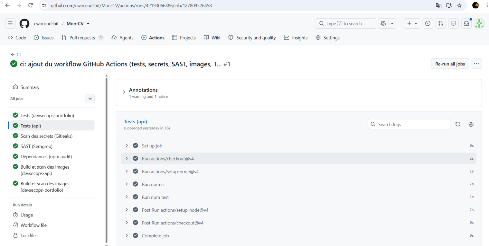
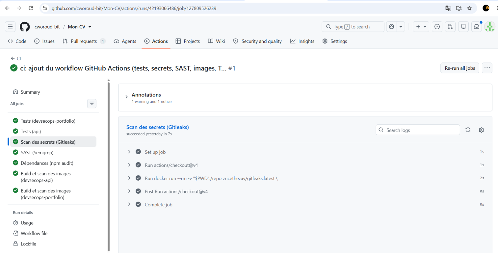
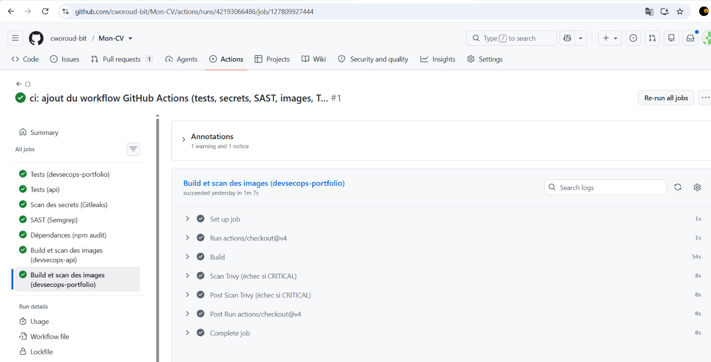
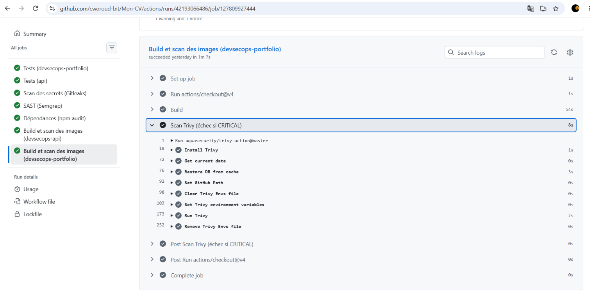

### 74. CodeQL et comparaison avec Semgrep

CodeQL (GitHub Advanced Security) est activé sur le dépôt. Semgrep est lancé par le job `sast`.

| Outil | Périmètre | Alertes |
|---|---|---|
| CodeQL | `main` et PR #1 | 0 (avertissement : 300 fichiers modifiés, diff incomplet sur la PR) |
| Semgrep | `activite-4`, 48 fichiers, 81 règles | 0 |
| Dependabot (hors SAST, pour référence) | `main` avant fusion | 4 (`next` ×3, `minimatch` ×1) |

Aucun des deux outils SAST ne détecte de faille dans le code applicatif, ce qui est cohérent avec la validation Zod, Helmet, le rate limiting et les requêtes Prisma paramétrées. Les vraies failles étaient dans les dépendances et l'image (`next`, `deepmerge-ts`, `tar`), que ni CodeQL ni Semgrep ne ciblent. Un résultat à 0 ne prouve pas l'absence de faille : les règles n'ont simplement rien trouvé.

| Critère | CodeQL | Semgrep |
|---|---|---|
| Méthode | Analyse du flux de données | Recherche de motifs (règles lisibles) |
| Vitesse | Plus lent (base de code à construire) | Très rapide |
| Intégration | Alertes dans l'onglet Security | Résultat dans le journal du job |
| Personnalisation | Requêtes QL, plus complexe | Règles YAML simples |
| Faux positifs | Non mesurés ici | Non mesurés ici |

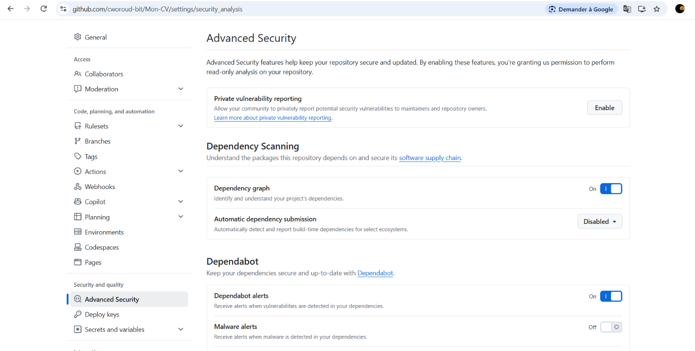
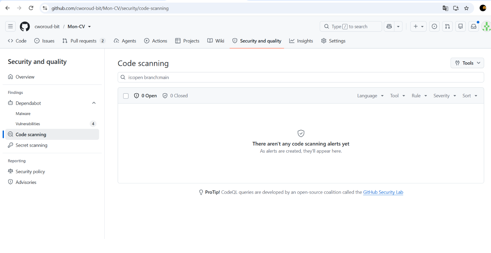
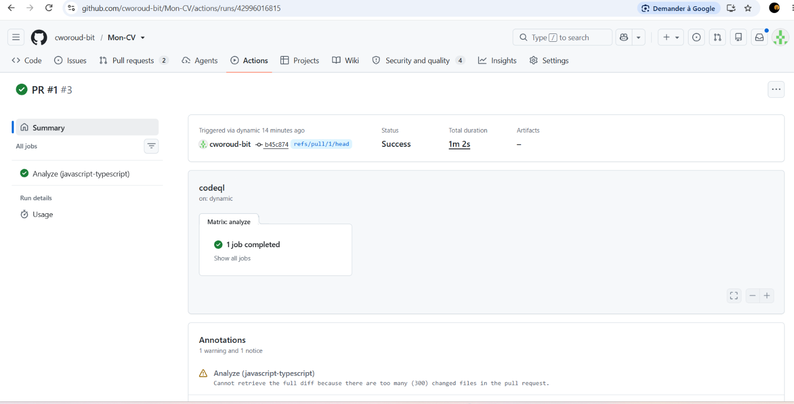

### 75. Dependabot

Fichier `.github/dependabot.yml` : Dependabot surveille les dépendances npm (`api` et `devsecops-portfolio`), Docker et les Actions GitHub, et ouvre automatiquement des Pull Requests. Les alertes sont dans **Security → Dependabot**.

Exemple : la PR #2 « Bump next from 16.4.0 to 16.4.1 » a été ouverte automatiquement. Elle propose 16.4.1 alors que 16.4.3 est la version corrigée utilisée sur `activite-4` : il faut relire ces PR avant de les fusionner.

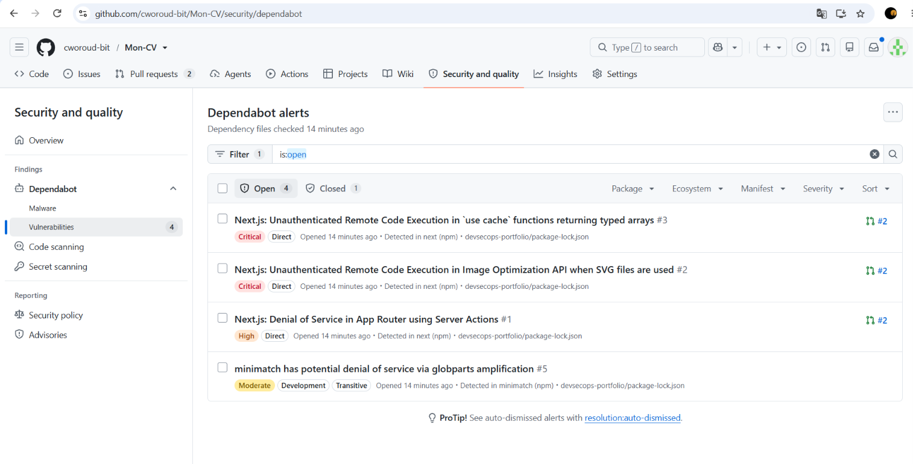
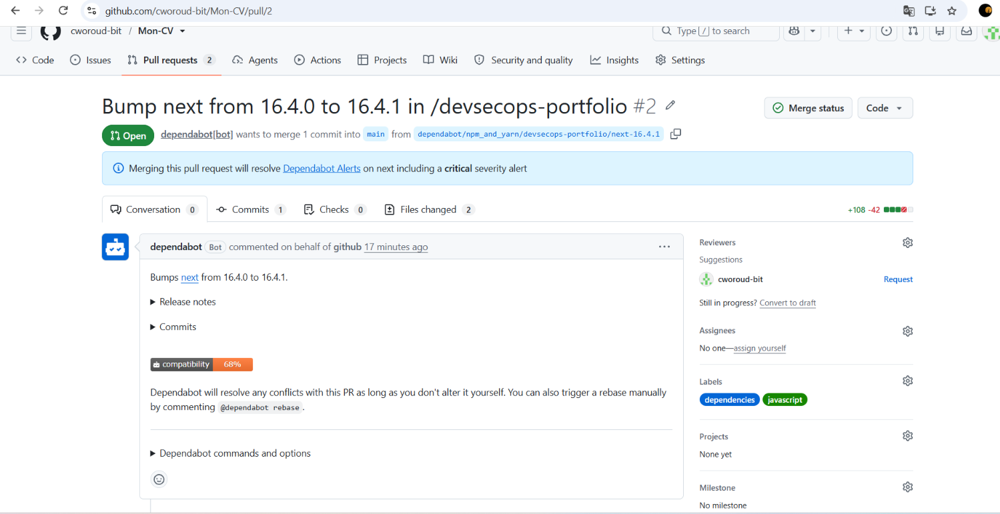

### 76. Permissions minimales du `GITHUB_TOKEN`

Chaque workflow déclare un bloc `permissions:` global avec le strict minimum, et seuls les jobs qui en ont besoin reçoivent plus.

```yaml
# ci.yml : lecture seule
permissions:
  contents: read
```

```yaml
# release.yml : lecture par défaut, écriture seulement pour le job de release
permissions:
  contents: read
jobs:
  release:
    permissions:
      contents: write
      issues: write
      pull-requests: write
```

`id-token: write` et `attestations: write` ne sont accordés qu'au job de publication (`publish.yml`).

### 77. Actions tierces épinglées par SHA de commit

Un tag (`actions/checkout@v4`) peut être déplacé vers un code malveillant. Le SHA d'un commit est immuable : les Actions sont épinglées ainsi, avec la version en commentaire.

```yaml
- uses: actions/checkout@11d5960a326750d5838078e36cf38b85af677262 # v4
```

Dependabot propose ensuite des mises à jour de ces SHA.

**Pourquoi les chaînes CI/CD sont une surface d'attaque.** Le pipeline reçoit du code, des secrets, les droits de publier des images et de créer des releases, et s'exécute automatiquement. Le compromettre permet de contourner toutes les protections du dépôt : il suffit d'altérer une Action utilisée, une dépendance ou un secret pour livrer du code malveillant ou voler des identifiants. Mesures du projet : permissions minimales (76), versions épinglées par SHA (77), protection de `main` et contrôles obligatoires (80 et 81), signature et vérification des images (99 à 104).

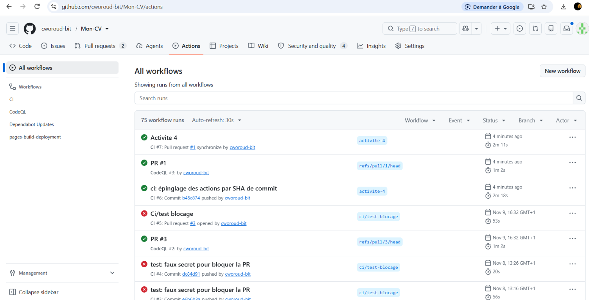

### 78. GitHub Actions et Jenkins

| Critère | GitHub Actions | Jenkins |
|---|---|---|
| Hébergement | Géré par GitHub (runners fournis) | Serveur auto-hébergé, à maintenir |
| Configuration | YAML dans `.github/workflows` | `Jenkinsfile` (Groovy) |
| Intégration au dépôt | Native : statuts de PR, CodeQL, Dependabot | Via plugins et webhooks |
| Isolation | Machine virtuelle neuve à chaque job | Espace de travail partagé |
| Réutilisation | Marketplace d'Actions (à épingler par SHA) | Plugins (à maintenir) |
| Réseau privé | Pas d'accès à la VM (runner auto-hébergé nécessaire) | Accès direct à l'infrastructure locale |
| Maintenance | Faible | Mises à jour, droits Docker, disque de la VM (a dépassé 80 %) |
| Cas d'usage ici | Contrôles avant merge, releases, signature | Pipeline avec OWASP Dependency-Check (base NVD conservée sur place) |

---

## 18. Git Workflow

### 79. Stratégie : branche, Pull Request, review, merge

Aucun travail n'est commité directement sur `main` :

```
branche -> commits -> Pull Request -> contrôles automatiques -> Squash and merge
```

Le dépôt n'a qu'un contributeur : le ruleset n'exige donc pas d'approbation humaine (0 review), et les 7 contrôles automatiques obligatoires tiennent lieu de relecture.

**Convention de nommage des branches :** `type/description-courte`, en minuscules avec des tirets, où `type` reprend les types de Conventional Commits.

| Préfixe | Usage | Exemple |
|---|---|---|
| `feat/` | Nouvelle fonctionnalité | `feat/optimisation-images` |
| `fix/` | Correction | `fix/validation-email` |
| `docs/` | Documentation | `docs/readme-activite5-v2` |
| `ci/` | Pipeline et automatisation | `ci/semantic-release`, `ci/sbom`, `ci/cosign` |
| `chore/` | Maintenance, dépendances | `chore/maj-dependances` |

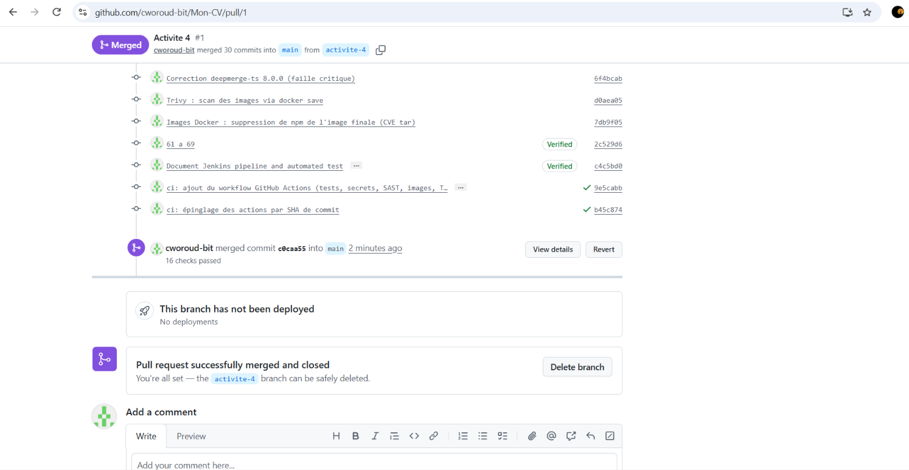

### 80. Protection de la branche principale

Le ruleset `protection-main` (**Settings → Rules → Rulesets**) interdit les push directs, la suppression et le force push sur `main`. Un push direct de test a été refusé (`GH013: Repository rule violations found`).

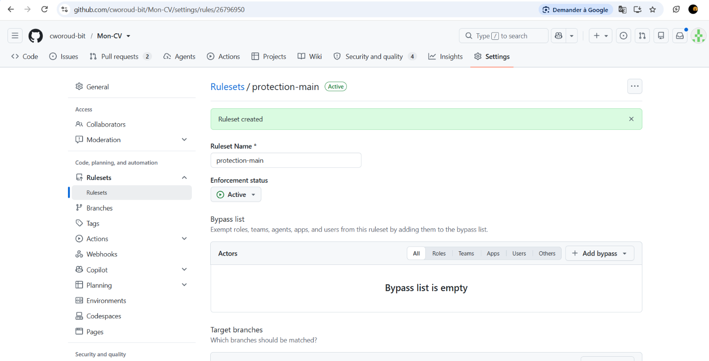
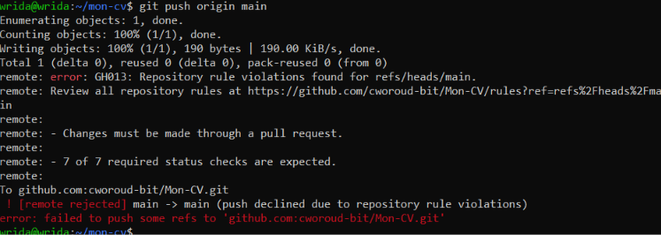

### 81. Contrôles obligatoires avant le merge

Le ruleset exige que 7 contrôles du workflow CI réussissent avant la fusion :

| Contrôle exigé | Job |
|---|---|
| Tests | `Tests (devsecops-portfolio)` et `Tests (api)` |
| Secrets | `Scan des secrets (Gitleaks)` |
| SAST | `SAST (Semgrep)` |
| Dépendances | `Dépendances (npm audit)` |
| Scan des images | `Build et scan des images (devsecops-api)` et `(devsecops-portfolio)` |

Pull Request volontairement bloquée (PR #3, branche `ci/test-blocage` contenant un faux secret : Gitleaks échoue, le bouton Merge est désactivé) :

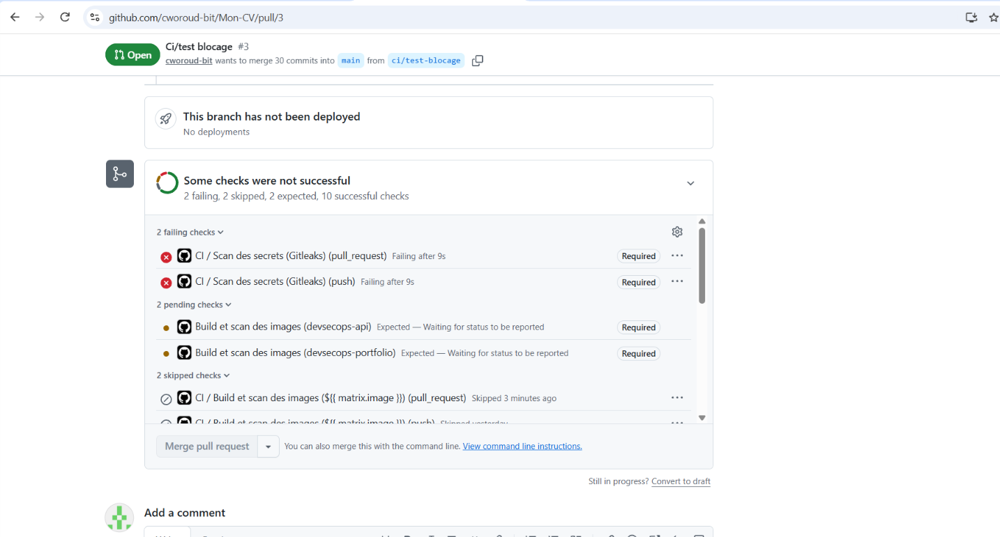

### 82. Conventional Commits

Format : `type: description`.

| Type | Usage | Exemple |
|---|---|---|
| `feat:` | Nouvelle fonctionnalité | `feat: ajout du formulaire de contact` |
| `fix:` | Correction | `fix: correction de la validation email` |
| `docs:` | Documentation | `docs: mise à jour du README` |
| `ci:`, `chore:`, `refactor:`, `test:` | Pipeline, maintenance, refactorisation, tests | `ci: ajout du workflow GitHub Actions` |

Avec « Squash and merge », le titre de la PR devient le message de commit sur `main` : il doit respecter ce format.

### 83. Semantic Versioning

Format `MAJOR.MINOR.PATCH` :

| Changement | Version | Commit |
|---|---|---|
| Correction | PATCH (1.0.0 vers 1.0.1) | `fix:` |
| Fonctionnalité compatible | MINOR (1.0.0 vers 1.1.0) | `feat:` |
| Rupture de compatibilité | MAJOR (1.0.0 vers 2.0.0) | `feat!:` ou `BREAKING CHANGE:` |

### 84. Releases automatiques avec semantic-release

À chaque push sur `main`, `semantic-release` lit les commits, calcule la version, crée le tag et la release GitHub avec les notes (changelog).

`.releaserc.json` :

```json
{
  "branches": ["main"],
  "plugins": [
    "@semantic-release/commit-analyzer",
    "@semantic-release/release-notes-generator",
    "@semantic-release/github"
  ]
}
```

`.github/workflows/release.yml` (job principal) :

```yaml
name: Release
on:
  push:
    branches: [main]
permissions:
  contents: read
jobs:
  release:
    name: Release (semantic-release)
    runs-on: ubuntu-latest
    permissions:
      contents: write
      issues: write
      pull-requests: write
    steps:
      - uses: actions/checkout@11d5960a326750d5838078e36cf38b85af677262 # v4
        with:
          fetch-depth: 0
      - uses: actions/setup-node@49933ea5288caeca8642d1e84afbd3f7d6820020 # v4
        with:
          node-version: 22
      - run: npx --yes semantic-release@24
        env:
          GITHUB_TOKEN: ${{ secrets.GITHUB_TOKEN }}
```

**Limite :** `main` est protégée contre les push directs, donc `semantic-release` ne peut pas commiter un `CHANGELOG.md`. Le changelog est généré dans les notes de la release GitHub. Les versions `v1.0.0` et `v1.1.0` ont été créées par les PR `feat:` #4 et #5.

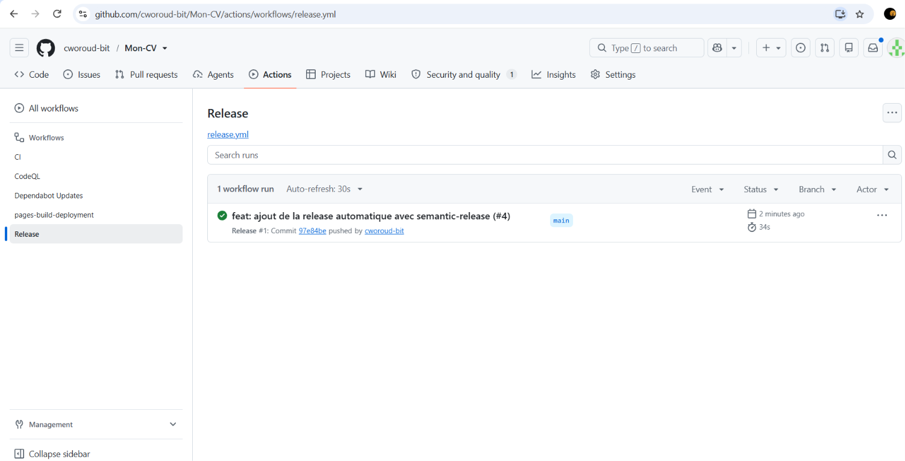
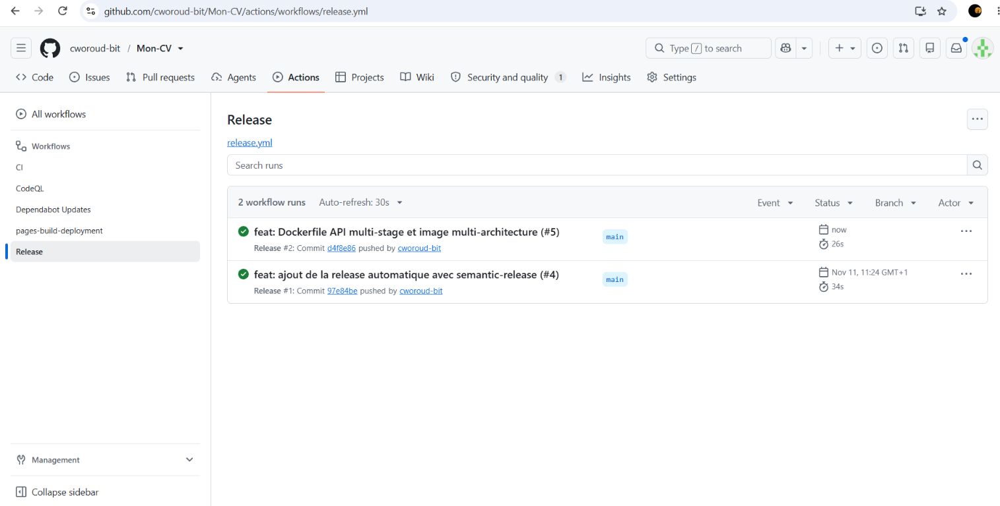

---

## 19. Optimisation des images

### 85 à 87. Mesures avant et après

Mesures faites avec `scripts/measure-images.sh` (taille, durée de build, scan Trivy `--ignore-unfixed`).

| Image | Indicateur | Avant | Après |
|---|---|---|---|
| `devsecops-api` | Taille | 745 Mo | 557 Mo (-25 %) |
| `devsecops-api` | Build | 122 s | 75 s |
| `devsecops-api` | Vulnérabilités | 4 (HIGH 3, MEDIUM 1) | 4 (HIGH 3, MEDIUM 1) |
| `devsecops-portfolio` | Taille | 289 Mo | 289 Mo |
| `devsecops-portfolio` | Build | 174 s | 85 s |
| `devsecops-portfolio` | Vulnérabilités | 54 (HIGH 7, MEDIUM 15, LOW 32) | 54 (HIGH 7, MEDIUM 15, LOW 32) |

Lecture des résultats :

- **API** : Dockerfile en deux stages (`builder` puis `runner` sans npm) et ajout d'un `.dockerignore`. Le gain de taille est réel.
- **Portfolio** : il était déjà multi-stage, son Dockerfile n'a pas changé. L'écart de durée (174 s vers 85 s) vient du cache Docker (mesure à froid puis à chaud), pas d'une optimisation.
- **Vulnérabilités** : inchangées, car elles viennent de l'image de base et des dépendances, pas de la structure des stages.
- La référence de 745 Mo est l'image après suppression de npm (activité 4, CVE `tar`) ; la première version pesait 820 Mo.

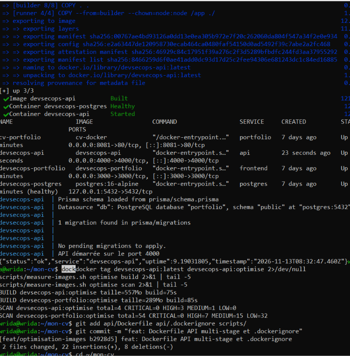

### 88. BuildKit et Buildx

Builder `multiarch` (driver `docker-container`) et émulation QEMU installée avec `tonistiigi/binfmt --install arm64`. Les Dockerfiles utilisent BuildKit (`--mount=type=cache` pour npm).

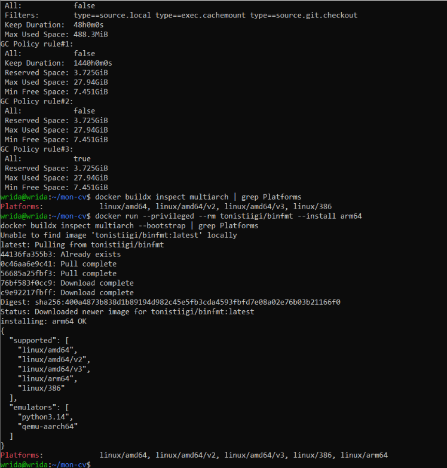

### 89. Image multi-architecture

```bash
docker buildx build --platform linux/amd64,linux/arm64 \
  -t localhost:5000/devsecops-api:multiarch --push ./api
docker buildx imagetools inspect localhost:5000/devsecops-api:multiarch
```

Résultat : un index OCI (`sha256:867b52a0...`) avec `linux/amd64` (`sha256:aec2148b...`) et `linux/arm64` (`sha256:55f92db3...`), plus deux manifestes d'attestation de provenance.

Limites : registre local temporaire (`registry:2`) ; l'arm64 est émulé (lent) ; le premier essai a échoué sur une résolution DNS, la reprise a réussi grâce au cache.


---

## 20. Registre privé Harbor

### 90. Installation

Harbor v2.15.5 installé sur la VM avec le scanner Trivy, en HTTP sur le port 8082 (test, sans certificat). Docker autorise ce registre via `insecure-registries`.

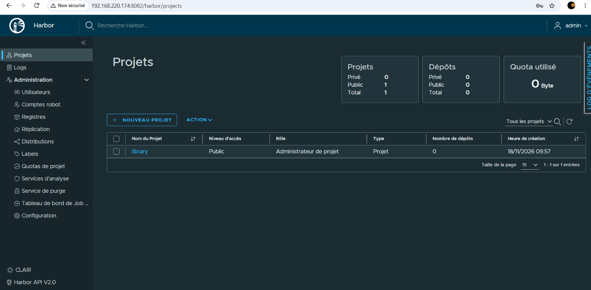

### 91. Images publiées

```
192.168.220.174:8082/devsecops/devsecops-api:v1
  digest sha256:8466259d6f0ae41add0dc93d17d25c2fee94306e681243dc1c84ed16885e1f6b
192.168.220.174:8082/devsecops/devsecops-portfolio:v1
  digest sha256:fd5b33e8cf6365bc1b2a289e30b48473a0fbd722396ce124409e3e9c268f4a7b
```

Publication faite depuis la VM avec le compte robot `pipeline` (`docker login` puis `docker push`). Limite : un runner GitHub ne peut pas joindre l'IP privée de la VM ; la publication automatique dans Harbor devrait passer par Jenkins ou un runner auto-hébergé (non mis en place). Les images publiées automatiquement par GitHub Actions vont dans `ghcr.io` (points 99 et suivants).

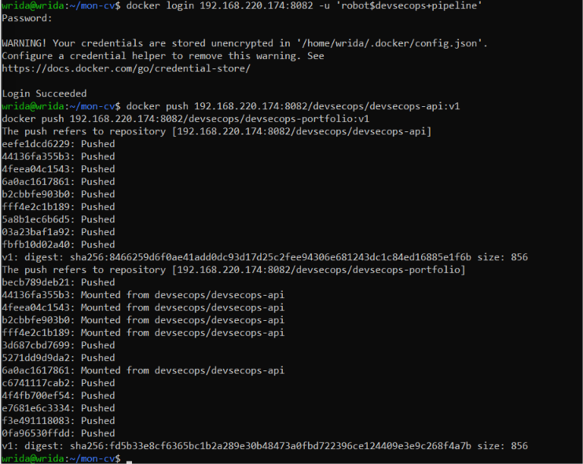


### 92. RBAC

- Projet `devsecops` en **privé**.
- Compte robot `pipeline`, limité au projet, permissions Push et Pull, avec expiration.
- Utilisateur humain avec rôle Développeur (push et pull, sans administration).

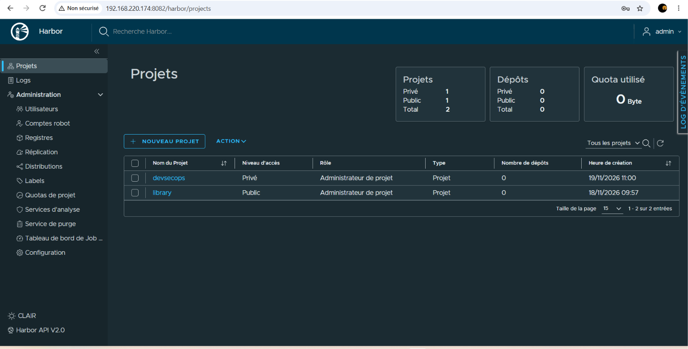
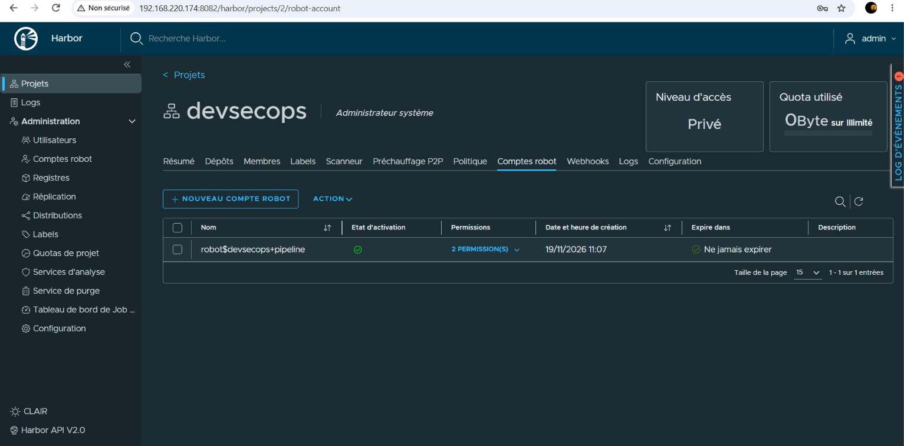

### 93. Scan automatique : Harbor et Trivy

| Image | Trivy du pipeline (13/11) | Harbor (20/11) |
|---|---|---|
| `devsecops-api` | 4 (HIGH 3, MEDIUM 1) | 5, toutes corrigeables, gravité max High |
| `devsecops-portfolio` | 54 (HIGH 7, MEDIUM 15, LOW 32) | 61, toutes corrigeables, gravité max High |

Les deux utilisent Trivy, mais les bases de vulnérabilités ont une semaine d'écart : c'est l'explication probable de l'écart (hypothèse, non vérifiée CVE par CVE). Le premier scan a échoué par dépassement de délai pendant le téléchargement de la base (réseau lent), puis a abouti.

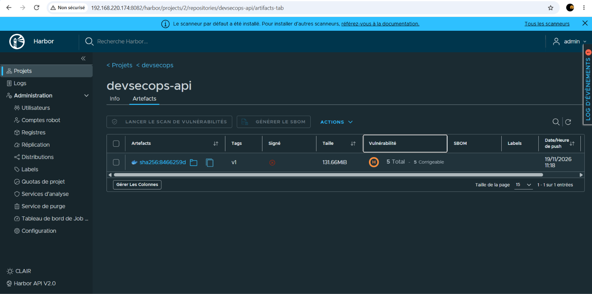
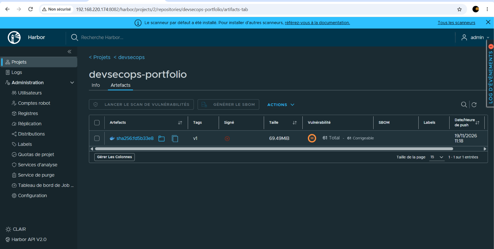

### 94. Rétention

Règle du projet `devsecops` : garder les images poussées dans les **5 derniers jours** (tous dépôts, tous tags, non tagués inclus), exécution hebdomadaire. Une simulation puis une exécution manuelle ont réussi.

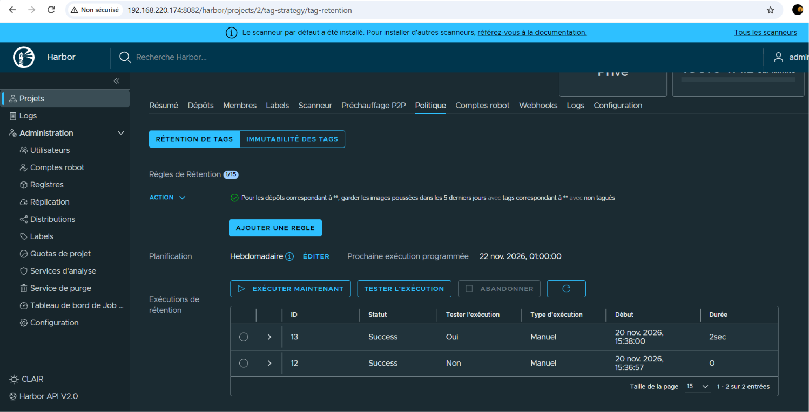

### 95. GitHub Container Registry et Harbor

| Critère | ghcr.io | Harbor |
|---|---|---|
| Hébergement | Géré par GitHub | Auto-hébergé (9 conteneurs sur la VM) |
| Mise en place | Aucune, `GITHUB_TOKEN` suffit | Installation, configuration, disque |
| Intégration CI | Native avec GitHub Actions | Réseau local seulement |
| Accès | Permissions GitHub | RBAC propre (projets, utilisateurs, robots) |
| Scan | Outil externe (Trivy en CI) | Trivy intégré |
| Rétention | Limitée | Politiques par projet |
| Données | Chez GitHub | Sur notre infrastructure |
| Coût | Gratuit (dépôt public) | Disque, mises à jour, supervision |

---

## 21. Software Supply Chain Security

### 96 à 98. SBOM (Syft)

- Le job `images` de `ci.yml` génère un SBOM SPDX JSON par image (`anchore/sbom-action`, épinglée par SHA) (96).
- Ils sont conservés comme artefacts du run : `sbom-devsecops-api`, `sbom-devsecops-portfolio` (97).
- Le job `sbom-release` de `release.yml` les génère et les attache à la dernière release GitHub (98). Un commit `ci:` ne crée pas de version : le SBOM est alors attaché à la release existante.

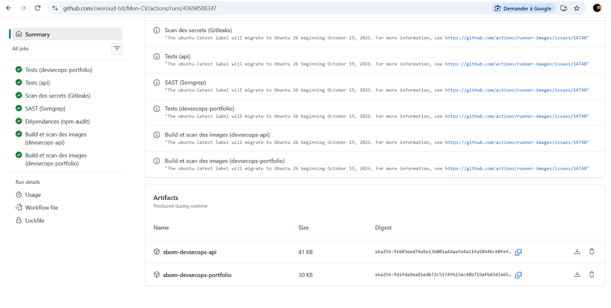
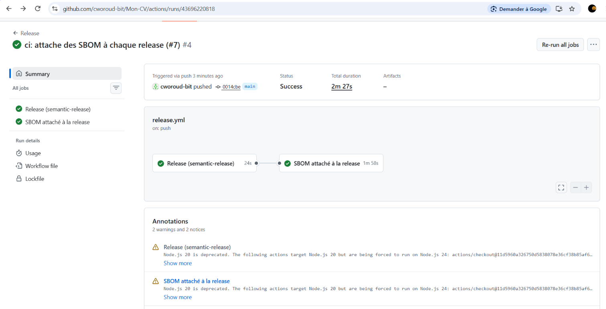

### 99 et 100. Signature Cosign

`publish.yml` publie les images dans `ghcr.io` puis les signe **sans clé** (Sigstore, identité OIDC du workflow), sur l'empreinte et non sur le tag.

```bash
cosign verify ghcr.io/cworoud-bit/devsecops-portfolio@sha256:a0c3dab7bd5eadfe490e65a02e8fcaeef7a34b0e30d0ab9e8e34b1a3c7441812 \
  --certificate-identity-regexp 'https://github.com/cworoud-bit/Mon-CV/.github/workflows/publish.yml@.*' \
  --certificate-oidc-issuer https://token.actions.githubusercontent.com
```

Résultat : signature `cosign/sign/v1` valide pour l'empreinte demandée.

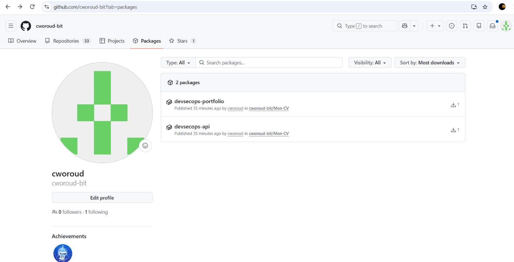
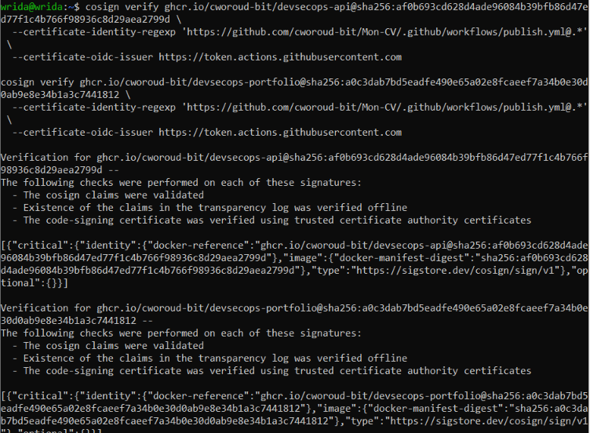

### 101 et 102. Attestation et provenance

`actions/attest-build-provenance` génère une attestation de provenance signée, publiée dans le registre. La **provenance** prouve l'origine d'un artefact : dépôt, workflow, commit, événement.

```bash
cosign verify-attestation ghcr.io/cworoud-bit/devsecops-api@sha256:d3b7f65bdacfe1da69c8bfb54f255a41ce9593bdc9c3222ba2cac87697787471 \
  --type slsaprovenance1 \
  --certificate-identity-regexp 'https://github.com/cworoud-bit/Mon-CV/.*' \
  --certificate-oidc-issuer https://token.actions.githubusercontent.com
```

Résultat : déclaration in-toto, `predicateType` `https://slsa.dev/provenance/v1`, dépôt `cworoud-bit/Mon-CV`, workflow `publish.yml`, branche `main`, événement `push`.

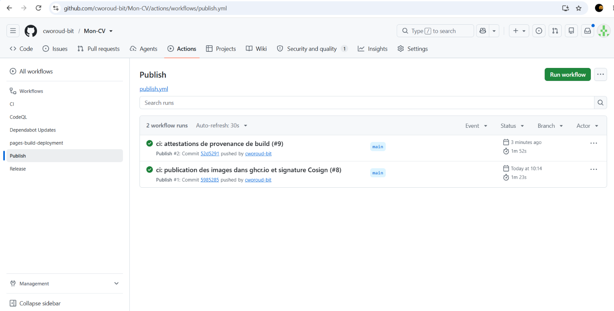
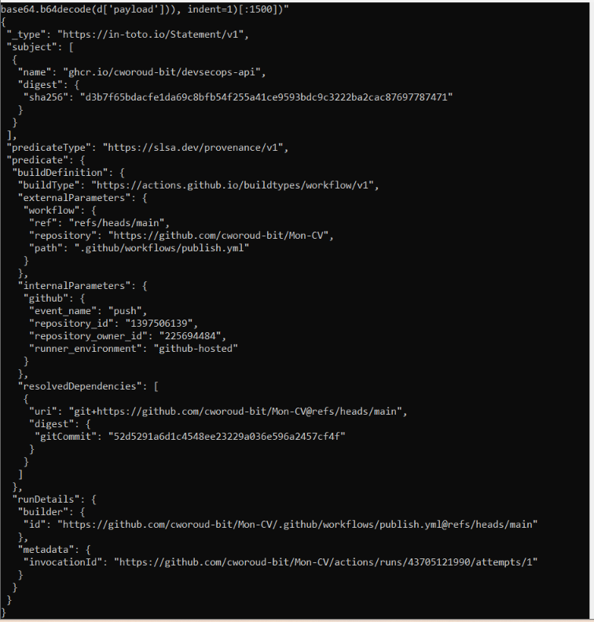

### 103. SLSA et in-toto

- **in-toto** : format de déclarations signées sur des artefacts, utilisé par les attestations.
- **SLSA** : niveaux de garantie sur la chaîne de build.
- Situation estimée : proche du **niveau 2** (build sur un service hébergé, provenance signée générée par la plateforme). Le niveau 3 demanderait un build isolé et non falsifiable (workflow réutilisable `slsa-github-generator`).

### 104. Refus d'une image non signée

`deploy.yml` exécute `cosign verify` avant toute livraison (identité du workflow `publish.yml` et émetteur OIDC GitHub exigés). Sans signature valide, le job échoue et l'étape « Livraison » n'est pas exécutée. Test positif : run #1 vert avec l'image signée.

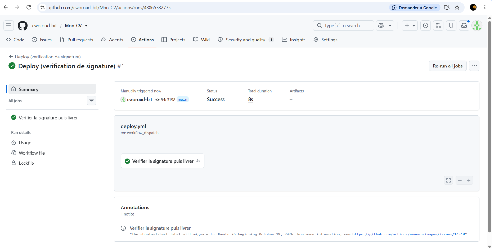

### 105. Simulation d'attaque

Scénario : une image non signée est publiée dans `ghcr.io` hors du workflow Publish (cas d'un attaquant). Le déploiement lancé avec son empreinte échoue (run #2 rouge) : `cosign verify` ne trouve aucune signature valide, et la livraison est bloquée.

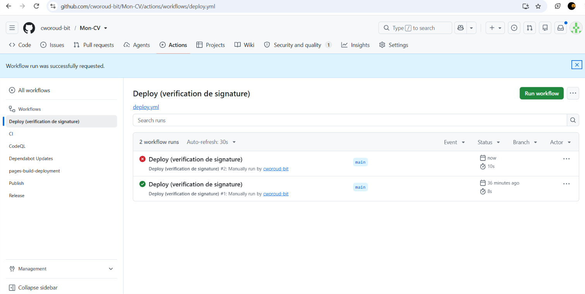
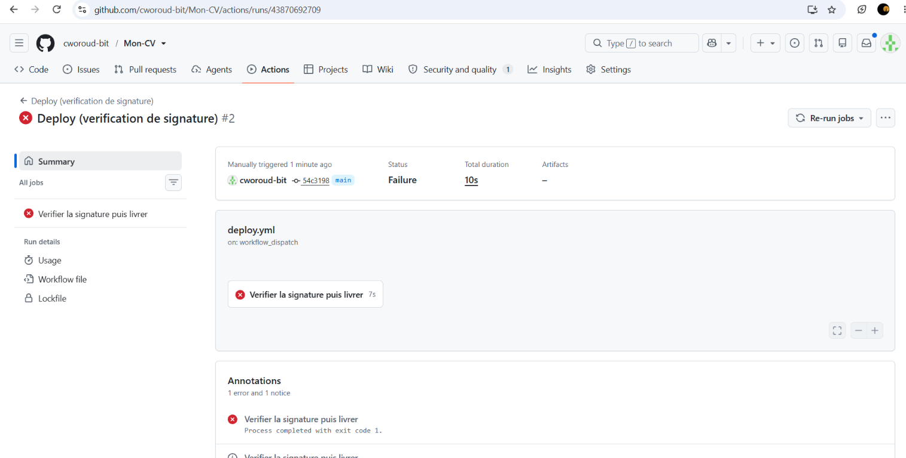

Nettoyage après le test : image non signée supprimée de `ghcr.io`, jeton d'accès révoqué.
