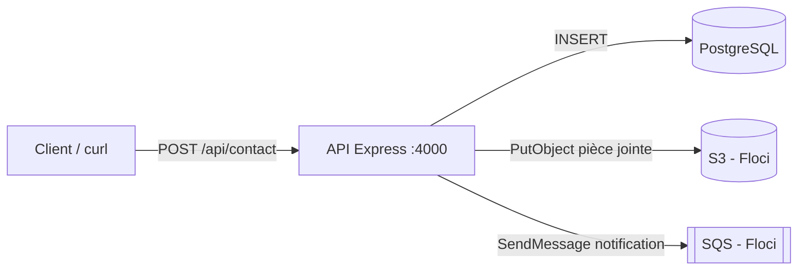
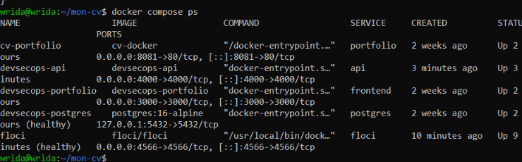
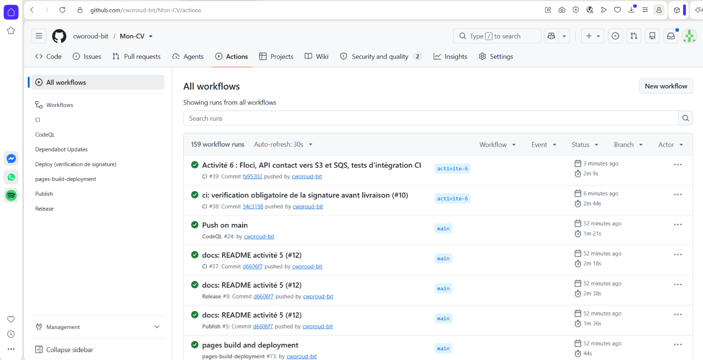
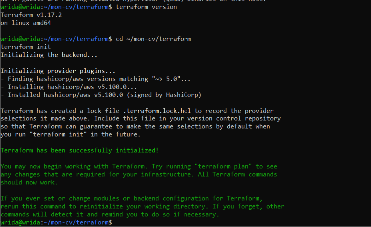
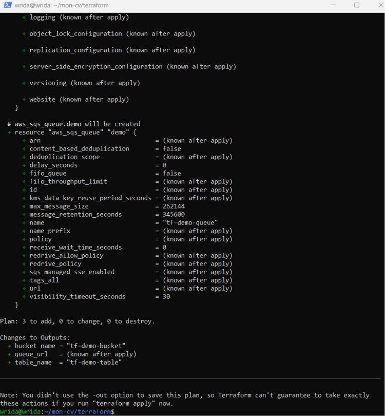

# Activité 6 : Cloud local avec Floci, Terraform et automatisation

## 22. Cloud local avec Floci

### 106. Installation de Floci

```bash
docker run -d --name floci -p 4566:4566 \
  -v /var/run/docker.sock:/var/run/docker.sock floci/floci
docker ps
```

Le socket Docker est monté pour que Floci puisse lancer les fonctions Lambda dans des conteneurs.

### 107. Configuration de l'AWS CLI

```bash
aws configure --profile floci      # test / test / us-east-1 / json
alias awsl='aws --endpoint-url http://localhost:4566'
export AWS_PROFILE=floci
awsl sts get-caller-identity
```

```json
{
    "UserId": "000000000000",
    "Account": "000000000000",
    "Arn": "arn:aws:iam::000000000000:root"
}
```

### 108. Bucket S3

```bash
awsl s3 mb s3://mon-bucket
```

```
make_bucket: mon-bucket
```

### 109. Envoi et récupération d'un fichier S3

```bash
echo "hello" > f.txt
awsl s3 cp f.txt s3://mon-bucket/
awsl s3 cp s3://mon-bucket/f.txt out.txt && cat out.txt
```

```
upload: ./f.txt to s3://mon-bucket/f.txt
download: s3://mon-bucket/f.txt to ./out.txt
hello
```

### 110. File SQS

```bash
awsl sqs create-queue --queue-name test-q
awsl sqs send-message --queue-url http://localhost:4566/000000000000/test-q --message-body "hi"
awsl sqs receive-message --queue-url http://localhost:4566/000000000000/test-q
```


### 111. Table DynamoDB

```bash
awsl dynamodb create-table --table-name users \
  --attribute-definitions AttributeName=id,AttributeType=S \
  --key-schema AttributeName=id,KeyType=HASH --billing-mode PAY_PER_REQUEST
awsl dynamodb put-item --table-name users --item '{"id":{"S":"1"},"name":{"S":"Ali"}}'
awsl dynamodb put-item --table-name users --item '{"id":{"S":"2"},"name":{"S":"Sara"}}'
awsl dynamodb scan --table-name users
```

### 112. Fonction Lambda Node.js

`index.js` :

```js
exports.handler = async (e) => ({statusCode:200, body:"ok"})
```

```bash
zip fn.zip index.js
awsl lambda create-function --function-name hello --runtime nodejs20.x \
  --handler index.handler --zip-file fileb://fn.zip \
  --role arn:aws:iam::000000000000:role/r
awsl lambda invoke --function-name hello out.json && cat out.json
```

```
{"statusCode":200,"body":"ok"}
```

### 113. Secrets Manager

```bash
awsl secretsmanager create-secret --name demo --secret-string "valeur"
awsl secretsmanager get-secret-value --secret-id demo
```

Le champ `SecretString` renvoie `"valeur"`.

### 114. API Express vers Floci (S3 et SQS)

La route `POST /api/contact` de l'API enregistre le message dans PostgreSQL, envoie la pièce jointe dans S3 et publie une notification dans SQS.



```bash
curl -s -X POST http://localhost:4000/api/contact \
  -F name=Wrida -F email=w@test.com -F message="Message avec piece jointe" \
  -F "attachment=@/tmp/pj.txt;type=text/plain"
```

```json
{"status":"ok","message":"Message bien reçu","id":12,"attachmentKey":"1795209671814-pj.txt","notificationId":"93eb03d6-4dcf-43de-96d6-6d8651b136f3"}
```

Les messages reçus dans la file SQS `contact-queue` :


### 115. Floci dans Docker Compose

Le service `floci` est ajouté au `docker-compose.yml`, l'API utilise `AWS_ENDPOINT_URL=http://floci:4566`.



### 116. Floci comme service container dans GitHub Actions

Le job `integration` du workflow `ci.yml` lance Floci comme service container et exécute les tests d'intégration sans compte AWS.




### 117. Comparaison : Floci, LocalStack et AWS réel

Informations vérifiées le 20 novembre 2026.

| Critère | Floci | LocalStack | AWS réel |
|---|---|---|---|
| Licence | MIT, open source | Propriétaire (l'édition Community Apache 2.0 est arrêtée depuis le 23 mars 2026) | Service commercial |
| Compte / token | Non | Oui (compte + auth token) | Oui (compte AWS) |
| Services | Large catalogue (S3, SQS, DynamoDB, Lambda, Secrets Manager, IAM...) | Selon le plan (Hobby, Base, Ultimate, Enterprise) | Catalogue complet |
| Fidélité | Bonne pour le développement et les tests, émulation (ne reproduit pas tous les cas limites) | Bonne, plus avancée dans les offres payantes | Référence, comportement exact |
| Coût | Gratuit | Gratuit en usage non commercial (Hobby), payant dès 39 $/licence/mois | Paiement à l'usage |
| Usage en CI | Simple : service container GitHub Actions, sans secret | Nécessite un auth token (secret) et une licence pour un usage commercial | Compte, identifiants et facturation, risque de coûts |
| Persistance | En mémoire par défaut (état perdu au redémarrage) | Selon l'édition | Permanente |

**Conclusion :** pour ce TP et pour la CI, Floci est le choix le plus adapté : gratuit, sans compte, sans secret, et le même code (AWS SDK, Terraform) fonctionne en changeant seulement l'endpoint. L'AWS réel reste nécessaire pour valider le comportement final et la production.

## 23. Introduction à Terraform

### 118. Installation de Terraform

```bash
sudo apt update
sudo apt install terraform -y
terraform version
```



### 119. Premier projet Terraform

Le projet se trouve dans le dossier `terraform/` et contient quatre fichiers : `providers.tf`, `main.tf`, `variables.tf` et `outputs.tf`. Le provider AWS est configuré pour utiliser les endpoints de Floci, avec des identifiants fictifs.

`providers.tf` :

```hcl
terraform {
  required_version = ">= 1.5.0"

  required_providers {
    aws = {
      source  = "hashicorp/aws"
      version = "~> 5.0"
    }
  }
}

# Identifiants fictifs : Floci n'a pas besoin de vrais identifiants
provider "aws" {
  region     = var.region
  access_key = "test"
  secret_key = "test"

  skip_credentials_validation = true
  skip_metadata_api_check     = true
  skip_requesting_account_id  = true
  s3_use_path_style           = true

  endpoints {
    s3             = var.endpoint
    sqs            = var.endpoint
    dynamodb       = var.endpoint
    sts            = var.endpoint
    iam            = var.endpoint
    lambda         = var.endpoint
    secretsmanager = var.endpoint
  }
}
```

`variables.tf` :

```hcl
variable "endpoint" {
  description = "URL de Floci (émulateur AWS local)"
  type        = string
  default     = "http://localhost:4566"
}

variable "region" {
  description = "Région AWS"
  type        = string
  default     = "us-east-1"
}

variable "bucket_name" {
  description = "Nom du bucket S3"
  type        = string
  default     = "tf-demo-bucket"
}

variable "queue_name" {
  description = "Nom de la file SQS"
  type        = string
  default     = "tf-demo-queue"
}

variable "table_name" {
  description = "Nom de la table DynamoDB"
  type        = string
  default     = "tf-demo-table"
}
```

`outputs.tf` :

```hcl
output "bucket_name" {
  description = "Nom du bucket S3 créé"
  value       = aws_s3_bucket.demo.bucket
}

output "queue_url" {
  description = "URL de la file SQS créée"
  value       = aws_sqs_queue.demo.url
}

output "table_name" {
  description = "Nom de la table DynamoDB créée"
  value       = aws_dynamodb_table.demo.name
}
```

Le fichier `main.tf` est présenté au point 121.

### 120. init, fmt, validate et plan

```bash
cd terraform
terraform init
terraform fmt
terraform validate
terraform plan
```



Le premier `terraform init` est long : le provider AWS (`hashicorp/aws` v5) pèse plusieurs centaines de Mo et le réseau de la VM est lent. Le téléchargement a été laissé se terminer.

### 121. Création des ressources avec Terraform

`main.tf` :

```hcl
resource "aws_s3_bucket" "demo" {
  bucket = var.bucket_name
}

resource "aws_sqs_queue" "demo" {
  name = var.queue_name
}

resource "aws_dynamodb_table" "demo" {
  name         = var.table_name
  billing_mode = "PAY_PER_REQUEST"
  hash_key     = "id"

  attribute {
    name = "id"
    type = "S"
  }
}
```

```bash
terraform apply
terraform output
```

Terraform crée trois ressources dans Floci : un bucket S3, une file SQS et une table DynamoDB.


### 122. Vérification avec l'AWS CLI

```bash
awsl s3 ls
awsl sqs list-queues
awsl dynamodb list-tables
```

Les trois ressources créées par Terraform (`tf-demo-bucket`, `tf-demo-queue`, `tf-demo-table`) sont bien présentes dans Floci.


### 123. Destruction des ressources

```bash
terraform destroy
```

Terraform supprime les trois ressources qu'il avait créées. Les ressources de l'API (`contact-attachments`, `contact-queue`) ne sont pas concernées, car elles ne sont pas gérées par Terraform.


## Problèmes rencontrés

- Le paquet `awscli` installé par `apt` affichait `badly formed help string` : remplacé par AWS CLI v2 (2.35.x).
- Lambda : le premier `invoke` échouait (timeout) car l'image `public.ecr.aws/lambda/nodejs:20` n'était pas encore téléchargée : `docker pull` préalable.
- Floci doit monter `/var/run/docker.sock` pour exécuter les fonctions Lambda.
