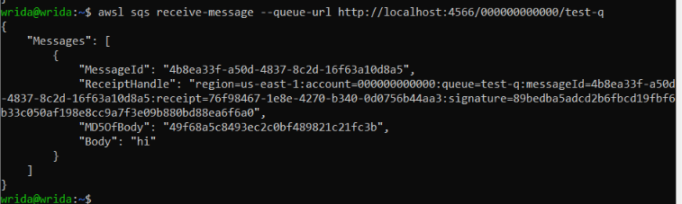
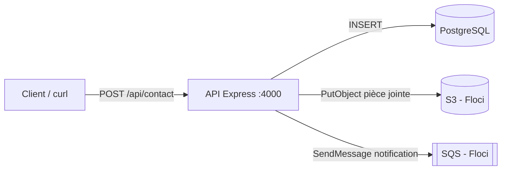
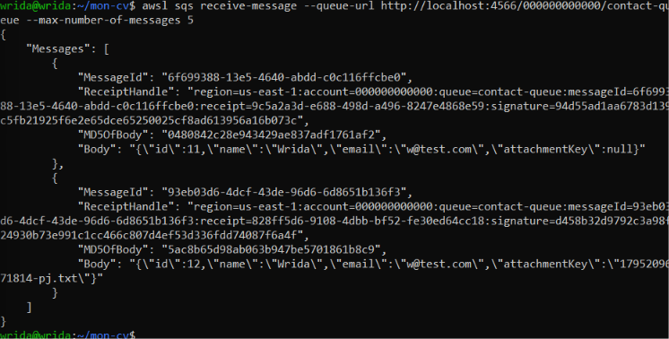
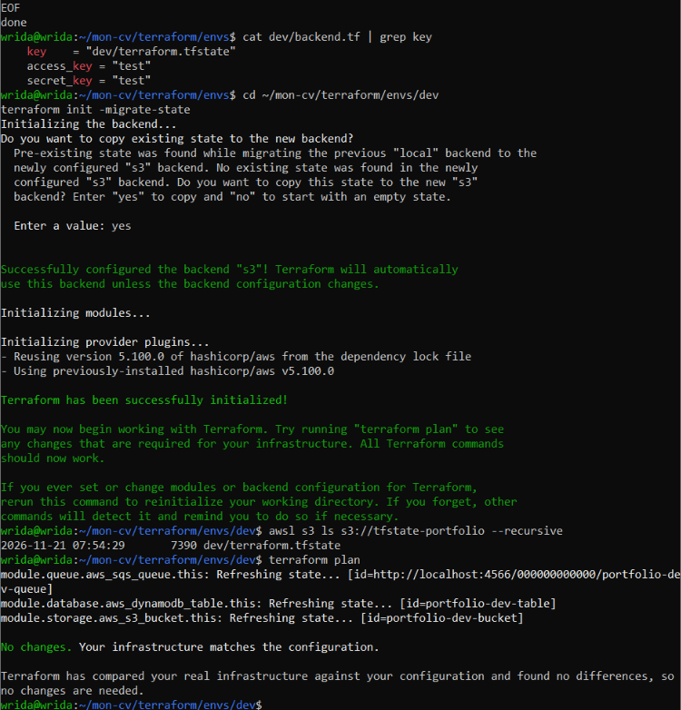
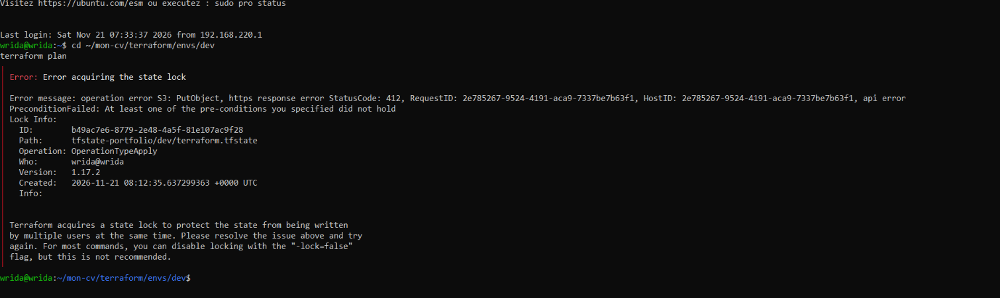
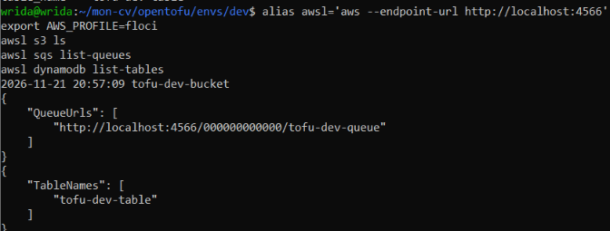

# Activité 6 : Cloud local avec Floci, Terraform et automatisation

## 22. Cloud local avec Floci

### 106. Installation de Floci

```bash
docker run -d --name floci -p 4566:4566 \
  -v /var/run/docker.sock:/var/run/docker.sock floci/floci
docker ps
```

Le socket Docker est monté pour que Floci puisse lancer les fonctions Lambda dans des conteneurs.

### 107. Configuration de l'AWS CLI

```bash
aws configure --profile floci      # test / test / us-east-1 / json
alias awsl='aws --endpoint-url http://localhost:4566'
export AWS_PROFILE=floci
awsl sts get-caller-identity
```

```json
{
    "UserId": "000000000000",
    "Account": "000000000000",
    "Arn": "arn:aws:iam::000000000000:root"
}
```

### 108. Bucket S3

```bash
awsl s3 mb s3://mon-bucket
```

```
make_bucket: mon-bucket
```

### 109. Envoi et récupération d'un fichier S3

```bash
echo "hello" > f.txt
awsl s3 cp f.txt s3://mon-bucket/
awsl s3 cp s3://mon-bucket/f.txt out.txt && cat out.txt
```

```
upload: ./f.txt to s3://mon-bucket/f.txt
download: s3://mon-bucket/f.txt to ./out.txt
hello
```

### 110. File SQS

```bash
awsl sqs create-queue --queue-name test-q
awsl sqs send-message --queue-url http://localhost:4566/000000000000/test-q --message-body "hi"
awsl sqs receive-message --queue-url http://localhost:4566/000000000000/test-q
```



### 111. Table DynamoDB

```bash
awsl dynamodb create-table --table-name users \
  --attribute-definitions AttributeName=id,AttributeType=S \
  --key-schema AttributeName=id,KeyType=HASH --billing-mode PAY_PER_REQUEST
awsl dynamodb put-item --table-name users --item '{"id":{"S":"1"},"name":{"S":"Ali"}}'
awsl dynamodb put-item --table-name users --item '{"id":{"S":"2"},"name":{"S":"Sara"}}'
awsl dynamodb scan --table-name users
```

### 112. Fonction Lambda Node.js

`index.js` :

```js
exports.handler = async (e) => ({statusCode:200, body:"ok"})
```

```bash
zip fn.zip index.js
awsl lambda create-function --function-name hello --runtime nodejs20.x \
  --handler index.handler --zip-file fileb://fn.zip \
  --role arn:aws:iam::000000000000:role/r
awsl lambda invoke --function-name hello out.json && cat out.json
```

```
{"statusCode":200,"body":"ok"}
```

### 113. Secrets Manager

```bash
awsl secretsmanager create-secret --name demo --secret-string "valeur"
awsl secretsmanager get-secret-value --secret-id demo
```

Le champ `SecretString` renvoie `"valeur"`.

### 114. API Express vers Floci (S3 et SQS)

La route `POST /api/contact` de l'API enregistre le message dans PostgreSQL, envoie la pièce jointe dans S3 et publie une notification dans SQS.



```bash
curl -s -X POST http://localhost:4000/api/contact \
  -F name=Wrida -F email=w@test.com -F message="Message avec piece jointe" \
  -F "attachment=@/tmp/pj.txt;type=text/plain"
```

```json
{"status":"ok","message":"Message bien reçu","id":12,"attachmentKey":"1795209671814-pj.txt","notificationId":"93eb03d6-4dcf-43de-96d6-6d8651b136f3"}
```

Les messages reçus dans la file SQS `contact-queue` :



### 115. Floci dans Docker Compose

Le service `floci` est ajouté au `docker-compose.yml`, l'API utilise `AWS_ENDPOINT_URL=http://floci:4566`.


### 116. Floci comme service container dans GitHub Actions

Le job `integration` du workflow `ci.yml` lance Floci comme service container et exécute les tests d'intégration sans compte AWS.


### 117. Comparaison : Floci, LocalStack et AWS réel

Informations vérifiées le 20 novembre 2026.

| Critère | Floci | LocalStack | AWS réel |
|---|---|---|---|
| Licence | MIT, open source | Propriétaire (l'édition Community Apache 2.0 est arrêtée depuis le 23 mars 2026) | Service commercial |
| Compte / token | Non | Oui (compte + auth token) | Oui (compte AWS) |
| Services | Large catalogue (S3, SQS, DynamoDB, Lambda, Secrets Manager, IAM...) | Selon le plan (Hobby, Base, Ultimate, Enterprise) | Catalogue complet |
| Fidélité | Bonne pour le développement et les tests, émulation (ne reproduit pas tous les cas limites) | Bonne, plus avancée dans les offres payantes | Référence, comportement exact |
| Coût | Gratuit | Gratuit en usage non commercial (Hobby), payant dès 39 $/licence/mois | Paiement à l'usage |
| Usage en CI | Simple : service container GitHub Actions, sans secret | Nécessite un auth token (secret) et une licence pour un usage commercial | Compte, identifiants et facturation, risque de coûts |
| Persistance | En mémoire par défaut (état perdu au redémarrage) | Selon l'édition | Permanente |

**Conclusion :** pour ce TP et pour la CI, Floci est le choix le plus adapté : gratuit, sans compte, sans secret, et le même code (AWS SDK, Terraform) fonctionne en changeant seulement l'endpoint. L'AWS réel reste nécessaire pour valider le comportement final et la production.

## 23. Introduction à Terraform

### 118. Installation de Terraform

```bash
sudo apt update
sudo apt install terraform -y
terraform version
```


### 119. Premier projet Terraform

Le projet se trouve dans le dossier `terraform/` et contient quatre fichiers : `providers.tf`, `main.tf`, `variables.tf` et `outputs.tf`. Le provider AWS est configuré pour utiliser les endpoints de Floci, avec des identifiants fictifs.

`providers.tf` :

```hcl
terraform {
  required_version = ">= 1.5.0"

  required_providers {
    aws = {
      source  = "hashicorp/aws"
      version = "~> 5.0"
    }
  }
}

# Identifiants fictifs : Floci n'a pas besoin de vrais identifiants
provider "aws" {
  region     = var.region
  access_key = "test"
  secret_key = "test"

  skip_credentials_validation = true
  skip_metadata_api_check     = true
  skip_requesting_account_id  = true
  s3_use_path_style           = true

  endpoints {
    s3             = var.endpoint
    sqs            = var.endpoint
    dynamodb       = var.endpoint
    sts            = var.endpoint
    iam            = var.endpoint
    lambda         = var.endpoint
    secretsmanager = var.endpoint
  }
}
```

`variables.tf` :

```hcl
variable "endpoint" {
  description = "URL de Floci (émulateur AWS local)"
  type        = string
  default     = "http://localhost:4566"
}

variable "region" {
  description = "Région AWS"
  type        = string
  default     = "us-east-1"
}

variable "bucket_name" {
  description = "Nom du bucket S3"
  type        = string
  default     = "tf-demo-bucket"
}

variable "queue_name" {
  description = "Nom de la file SQS"
  type        = string
  default     = "tf-demo-queue"
}

variable "table_name" {
  description = "Nom de la table DynamoDB"
  type        = string
  default     = "tf-demo-table"
}
```

`outputs.tf` :

```hcl
output "bucket_name" {
  description = "Nom du bucket S3 créé"
  value       = aws_s3_bucket.demo.bucket
}

output "queue_url" {
  description = "URL de la file SQS créée"
  value       = aws_sqs_queue.demo.url
}

output "table_name" {
  description = "Nom de la table DynamoDB créée"
  value       = aws_dynamodb_table.demo.name
}
```

Le fichier `main.tf` est présenté au point 121.

### 120. init, fmt, validate et plan

```bash
cd terraform
terraform init
terraform fmt
terraform validate
terraform plan
```


Le premier `terraform init` est long : le provider AWS (`hashicorp/aws` v5) pèse plusieurs centaines de Mo et le réseau de la VM est lent. Le téléchargement a été laissé se terminer.

### 121. Création des ressources avec Terraform

`main.tf` :

```hcl
resource "aws_s3_bucket" "demo" {
  bucket = var.bucket_name
}

resource "aws_sqs_queue" "demo" {
  name = var.queue_name
}

resource "aws_dynamodb_table" "demo" {
  name         = var.table_name
  billing_mode = "PAY_PER_REQUEST"
  hash_key     = "id"

  attribute {
    name = "id"
    type = "S"
  }
}
```

```bash
terraform apply
terraform output
```

Terraform crée trois ressources dans Floci : un bucket S3, une file SQS et une table DynamoDB.


### 122. Vérification avec l'AWS CLI

```bash
awsl s3 ls
awsl sqs list-queues
awsl dynamodb list-tables
```

Les trois ressources créées par Terraform (`tf-demo-bucket`, `tf-demo-queue`, `tf-demo-table`) sont bien présentes dans Floci.


### 123. Destruction des ressources

```bash
terraform destroy
```

Terraform supprime les trois ressources qu'il avait créées. Les ressources de l'API (`contact-attachments`, `contact-queue`) ne sont pas concernées, car elles ne sont pas gérées par Terraform.


## 24. Terraform avancé

### 124. Modules réutilisables

La configuration de l'exercice 121 est transformée en trois modules réutilisables, un par type de ressource. Chaque module reçoit ses paramètres par des variables et expose ses résultats par des sorties.

```
terraform/
├── basic/                  # projet de l'exercice 119 à 123
├── modules/
│   ├── storage/            # bucket S3
│   ├── queue/              # file SQS
│   └── database/           # table DynamoDB
└── envs/
    ├── dev/
    ├── staging/
    └── prod/
```

Chaque module contient `main.tf`, `variables.tf` et `outputs.tf`. Exemple, `modules/queue/main.tf` :

```hcl
resource "aws_sqs_queue" "this" {
  name                       = var.queue_name
  visibility_timeout_seconds = var.visibility_timeout_seconds
  message_retention_seconds  = var.message_retention_seconds

  tags = {
    Environment = var.environment
    ManagedBy   = "terraform"
  }
}
```


### 125. Configurations séparées : dev, staging et prod

Chaque environnement est un projet Terraform indépendant dans `envs/<env>/`, avec son propre état. Il appelle les mêmes modules, et seul le fichier `terraform.tfvars` change.

`envs/dev/main.tf` (identique pour les trois environnements) :

```hcl
module "storage" {
  source = "../../modules/storage"

  bucket_name = "${var.project}-${var.environment}-bucket"
  environment = var.environment
}

module "queue" {
  source = "../../modules/queue"

  queue_name                 = "${var.project}-${var.environment}-queue"
  environment                = var.environment
  visibility_timeout_seconds = var.queue_visibility_timeout
  message_retention_seconds  = var.queue_retention_seconds
}

module "database" {
  source = "../../modules/database"

  table_name  = "${var.project}-${var.environment}-table"
  environment = var.environment
}
```

Valeurs propres à chaque environnement :

| Environnement | `environment` | Timeout de visibilité SQS | Conservation des messages SQS |
|---|---|---|---|
| dev | `dev` | 30 s | 1 jour |
| staging | `staging` | 60 s | 4 jours |
| prod | `prod` | 120 s | 14 jours |

Les ressources sont nommées avec l'environnement (`portfolio-dev-bucket`, `portfolio-staging-queue`, `portfolio-prod-table`), ce qui permet de les déployer côte à côte dans Floci.

```bash
cd terraform/envs/dev
terraform init
terraform plan
terraform apply
```


### 126. Le rôle du fichier Terraform State

Le fichier d'état (`terraform.tfstate`) est la mémoire de Terraform. Il fait le lien entre les ressources décrites dans le code et les ressources réellement créées : identifiants, ARN et attributs de chaque ressource.

À chaque `terraform plan`, Terraform compare trois choses : le code, l'état et l'infrastructure réelle. C'est cette comparaison qui lui permet de savoir ce qu'il doit créer, modifier ou détruire. Sans état, il ne saurait pas que le bucket existe déjà et chercherait à le recréer.

Deux points importants :

- Le fichier peut contenir des informations sensibles en clair. Il ne doit donc pas être versionné dans Git (il est dans le `.gitignore`).
- En local, il n'est pas partageable et pas protégé contre deux exécutions simultanées. C'est pourquoi on le stocke dans un backend distant avec verrouillage (exercices 127 et 128).

### 127. Backend distant S3 hébergé dans Floci

Le state de chaque environnement est stocké dans un bucket S3 de Floci, avec une clé par environnement (`dev/terraform.tfstate`, `staging/terraform.tfstate`, `prod/terraform.tfstate`).

```bash
awsl s3 mb s3://tfstate-portfolio
```

`envs/dev/backend.tf` :

```hcl
terraform {
  backend "s3" {
    bucket = "tfstate-portfolio"
    key    = "dev/terraform.tfstate"
    region = "us-east-1"

    endpoints = {
      s3  = "http://localhost:4566"
      sts = "http://localhost:4566"
    }

    # Identifiants fictifs : Floci n'a pas besoin de vrais identifiants
    access_key = "test"
    secret_key = "test"

    use_path_style              = true
    skip_credentials_validation = true
    skip_metadata_api_check     = true
    skip_requesting_account_id  = true
    skip_region_validation      = true

    # Verrouillage du state (128)
    use_lockfile = true
  }
}
```

Le state local de `dev` est migré vers le backend distant :

```bash
cd terraform/envs/dev
terraform init -migrate-state
awsl s3 ls s3://tfstate-portfolio --recursive
terraform plan
```

Le `terraform plan` qui suit la migration indique `No changes` : les ressources existantes sont bien retrouvées dans le state distant.



### 128. Verrouillage du state

L'option `use_lockfile = true` active le verrouillage natif du backend S3 : pendant une opération, Terraform dépose un fichier `terraform.tfstate.tflock` à côté du state, avec une écriture conditionnelle. Si le fichier existe déjà, la seconde exécution est refusée.

Test : un premier terminal lance `terraform apply` et reste en attente de confirmation (le verrou est alors pris). Un second terminal lance `terraform plan` sur le même environnement :

```
Error: Error acquiring the state lock

Error message: operation error S3: PutObject, https response error StatusCode: 412 ...
PreconditionFailed: At least one of the pre-conditions you specified did not hold
Lock Info:
  Path:      tfstate-portfolio/dev/terraform.tfstate
  Operation: OperationTypeApply
```

Le fichier de verrou est visible dans le bucket :

```bash
awsl s3 ls s3://tfstate-portfolio/dev/
```

```
terraform.tfstate
terraform.tfstate.tflock
```

Dès que le premier terminal termine ou annule l'opération, le verrou disparaît et le `terraform plan` suivant fonctionne.



### 129. Analyse du code Terraform dans le pipeline (Trivy IaC)

Un job `iac` est ajouté au workflow `.github/workflows/ci.yml`. Il analyse le dossier `terraform/` avec Trivy (`trivy config`) et échoue si une misconfiguration de sévérité HIGH ou CRITICAL est trouvée. Le projet d'introduction `basic/` (exercices 118 à 123) et le cache `.terraform` sont exclus du scan.

```yaml
  iac:
    name: Scan IaC (Trivy)
    runs-on: ubuntu-latest
    steps:
      - uses: actions/checkout@11d5960a326750d5838078e36cf38b85af677262 # v4
      - name: Analyse du code Terraform (échec si HIGH ou CRITICAL)
        run: |
          docker run --rm -v "$PWD/terraform":/tf aquasec/trivy:latest \
            config /tf --severity HIGH,CRITICAL --exit-code 1 \
            --skip-dirs "**/.terraform" --skip-dirs "**/basic"
```

Le premier scan des modules a trouvé des problèmes réels, corrigés dans le code :

| Règle | Problème | Correction |
|---|---|---|
| AWS-0086, 0087, 0091, 0093 | Pas de blocage de l'accès public sur le bucket S3 | Ressource `aws_s3_bucket_public_access_block` avec les quatre options à `true` |
| AWS-0096 | File SQS non chiffrée | `sqs_managed_sse_enabled = true` |
| AWS-0132 | Bucket non chiffré avec une clé KMS gérée par le client | Exception volontaire et justifiée dans le code (`#trivy:ignore:AVD-AWS-0132`) : le chiffrement SSE-S3 par défaut suffit pour ce TP |

Après correction, le scan retourne `Failures: 0` et le code de sortie 0.

Un faux positif Gitleaks est apparu dans la même CI : la réponse JSON de l'API collée dans ce README (clé de pièce jointe horodatée et identifiant de message SQS) a été prise pour une clé d'API (règle `generic-api-key`). Ce n'est pas un secret. Le résultat est ignoré par son empreinte dans le fichier `.gitleaksignore`, avec un commentaire de justification, sans désactiver le scan.


### 130. Mauvaise configuration volontaire détectée par le pipeline

Sur une branche de test (`test-iac-echec`), trois erreurs sont introduites volontairement dans les modules :

- un bucket S3 en lecture publique (`acl = "public-read"`)
- le blocage d'accès public désactivé (les quatre options à `false`)
- la file SQS sans chiffrement (`sqs_managed_sse_enabled = false`)

```hcl
resource "aws_s3_bucket_acl" "bad" {
  bucket = aws_s3_bucket.this.id
  acl    = "public-read"
}
```

Résultat : le job `Scan IaC (Trivy)` échoue et fait échouer le pipeline, alors que les autres contrôles (Gitleaks, Semgrep, npm audit, tests, tests d'intégration Floci) restent verts. C'est donc bien l'analyse du code d'infrastructure qui détecte le problème.


La branche de test n'est jamais fusionnée : elle est supprimée après les captures, et la branche `activite-6` garde la configuration saine.

### 129. Analyse du code Terraform dans le pipeline (Trivy IaC)

Un job `iac` est ajouté au workflow `.github/workflows/ci.yml`. Il analyse le dossier `terraform/` avec Trivy (`trivy config`) et échoue si une misconfiguration de sévérité HIGH ou CRITICAL est trouvée. Le projet d'introduction `basic/` (exercices 118 à 123) et le cache `.terraform` sont exclus du scan.

```yaml
  iac:
    name: Scan IaC (Trivy)
    runs-on: ubuntu-latest
    steps:
      - uses: actions/checkout@11d5960a326750d5838078e36cf38b85af677262 # v4
      - name: Analyse du code Terraform (échec si HIGH ou CRITICAL)
        run: |
          docker run --rm -v "$PWD/terraform":/tf aquasec/trivy:latest \
            config /tf --severity HIGH,CRITICAL --exit-code 1 \
            --skip-dirs "**/.terraform" --skip-dirs "**/basic"
```

Le premier scan des modules a trouvé des problèmes réels, corrigés dans le code :

| Règle | Problème | Correction |
|---|---|---|
| AWS-0086, 0087, 0091, 0093 | Pas de blocage de l'accès public sur le bucket S3 | Ressource `aws_s3_bucket_public_access_block` avec les quatre options à `true` |
| AWS-0096 | File SQS non chiffrée | `sqs_managed_sse_enabled = true` |
| AWS-0132 | Bucket non chiffré avec une clé KMS gérée par le client | Exception volontaire et justifiée dans le code (`#trivy:ignore:AVD-AWS-0132`) : le chiffrement SSE-S3 par défaut suffit pour ce TP |

Après correction, le scan retourne `Failures: 0` et le code de sortie 0.

Un faux positif Gitleaks est apparu dans la même CI : la réponse JSON de l'API collée dans ce README (clé de pièce jointe horodatée et identifiant de message SQS) a été prise pour une clé d'API (règle `generic-api-key`). Ce n'est pas un secret. Le résultat est ignoré par son empreinte dans le fichier `.gitleaksignore`, avec un commentaire de justification, sans désactiver le scan.


### 130. Mauvaise configuration volontaire détectée par le pipeline

Sur une branche de test (`test-iac-echec`), trois erreurs sont introduites volontairement dans les modules :

- un bucket S3 en lecture publique (`acl = "public-read"`)
- le blocage d'accès public désactivé (les quatre options à `false`)
- la file SQS sans chiffrement (`sqs_managed_sse_enabled = false`)

```hcl
resource "aws_s3_bucket_acl" "bad" {
  bucket = aws_s3_bucket.this.id
  acl    = "public-read"
}
```

Résultat : le job `Scan IaC (Trivy)` échoue et fait échouer le pipeline, alors que les autres contrôles (Gitleaks, Semgrep, npm audit, tests, tests d'intégration Floci) restent verts. C'est donc bien l'analyse du code d'infrastructure qui détecte le problème.


La branche de test n'est jamais fusionnée : elle est supprimée après les captures, et la branche `activite-6` garde la configuration saine.

### 131. Test d'OpenTofu avec la même infrastructure

OpenTofu est installé avec snap, puis exécuté sur exactement le même code HCL que Terraform (mêmes modules, même environnement `dev`).

```bash
sudo snap install opentofu --classic
tofu version
```

Le projet est copié dans `opentofu/` (modules et environnement `dev`, sans le fichier `backend.tf`, donc avec un state local). La variable `project` est passée en ligne de commande pour que les ressources s'appellent `tofu-dev-...` et ne rentrent pas en conflit avec celles de Terraform (`portfolio-dev-...`) :

```bash
cd opentofu/envs/dev
tofu init
tofu validate
tofu plan -var="project=tofu"
tofu apply -var="project=tofu"
```

Résultat : `Apply complete! Resources: 4 added, 0 changed, 0 destroyed.` (bucket S3, blocage d'accès public, file SQS et table DynamoDB). Les ressources sont visibles dans Floci à côté de celles créées par Terraform.




**Difficulté rencontrée :** OpenTofu télécharge ses providers depuis son propre registre (`registry.opentofu.org`) et n'utilise pas le cache de Terraform. Le provider AWS pèse plusieurs centaines de Mo et la connexion de la VM est lente. La solution a été de configurer un miroir local dans `~/.tofurc` (`filesystem_mirror`) pointant vers le provider déjà téléchargé par Terraform : `tofu init` s'exécute alors en quelques secondes, sans téléchargement.

**Comparaison avec Terraform :**

| Critère | Terraform | OpenTofu |
|---|---|---|
| Commande | `terraform` | `tofu` |
| Licence | BUSL (source disponible, usage commercial restreint) | MPL-2.0, open source (Linux Foundation) |
| Code HCL | Référence | Identique, aucune modification nécessaire |
| Registre de providers | `registry.terraform.io` | `registry.opentofu.org` |
| Fichiers générés | `.terraform/`, `.terraform.lock.hcl`, `terraform.tfstate` | Mêmes fichiers, même format de state |
| Résultat sur Floci | 4 ressources créées | 4 ressources créées, comportement identique |
| Fonctionnalité propre | | Chiffrement natif du state |

**Conclusion :** pour ce projet, OpenTofu est un remplaçant direct de Terraform : même code, même résultat. Le choix se fait donc surtout sur la licence et la gouvernance du projet.

## Problèmes rencontrés

- Le paquet `awscli` installé par `apt` affichait `badly formed help string` : remplacé par AWS CLI v2 (2.35.x).
- Lambda : le premier `invoke` échouait (timeout) car l'image `public.ecr.aws/lambda/nodejs:20` n'était pas encore téléchargée : `docker pull` préalable.
- Floci doit monter `/var/run/docker.sock` pour exécuter les fonctions Lambda.
